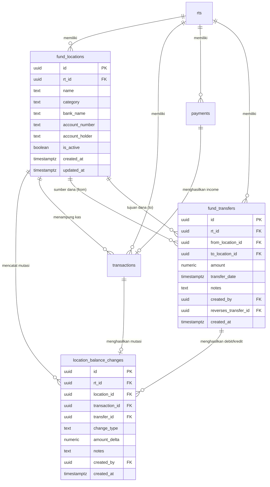
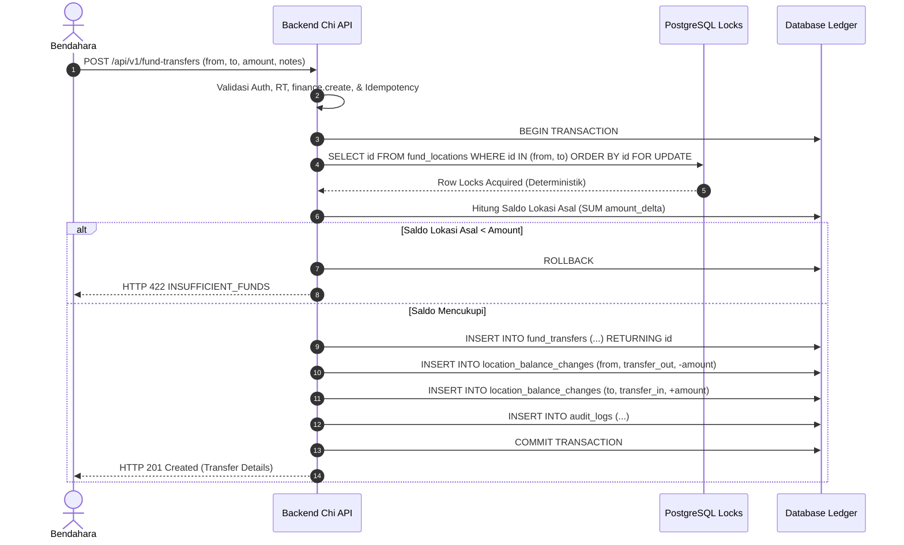
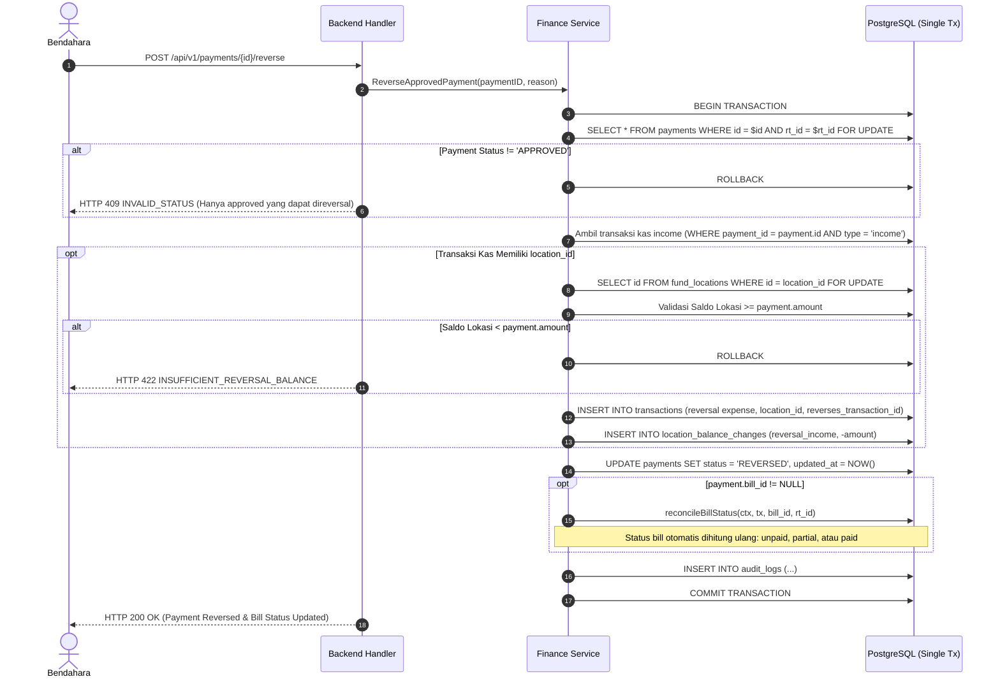
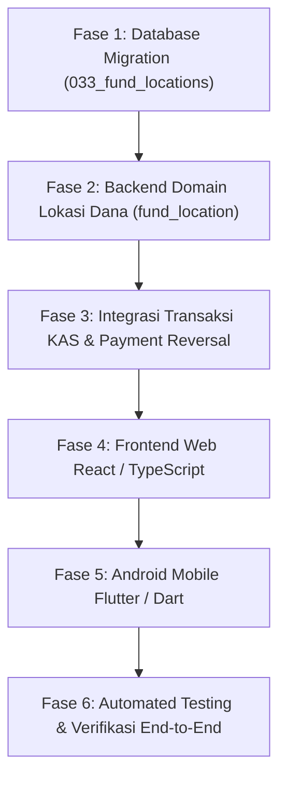

# Spesifikasi Teknis dan Fungsional Final: Fitur Lokasi Dana (Cash Position Tracking)

> **Status Dokumen:** FINAL — READY FOR IMPLEMENTATION  
> **Tanggal Pembuatan:** 10 Oktober 2025  
> **Tanggal Audit & Revisi Final:** 25 Oktober 2026  
> **Aplikasi / Workspace:** Social Finance Urena (`andjoy404/social-finance`)  
> **Branch Kerja:** `urena` (HEAD `dfdbe8c`)  
> **Otorisasi Keputusan:** Seluruh 15 Keputusan Bisnis & Arsitektur telah **RESOLVED & APPROVED** bersama Pemilik Proyek. Seluruh 4 Area GAP (GAP A: Invariant $D=K-(L+U)=0$ & Saldo Awal, GAP B: Seleksi Iuran Multi-Akun Deterministik, GAP C: Rollout Bertahap & Telemetri, GAP D: Reversal Pembayaran Iuran Approved) telah diselesaikan secara konsisten dan terverifikasi terhadap arsitektur aktual.  
> **Konvensi Pelabelan Dokumen:**  
> - **[Fakta Repository]**: Fakta terbukti secara langsung dari kode sumber backend Go, frontend React, mobile Flutter, skema PostgreSQL, atau konfigurasi repository aktif.  
> - **[Desain Baru]**: Komponen arsitektur, tabel, endpoint, atau fungsi baru yang dirancang khusus untuk fitur Lokasi Dana dan wajib dibangun pada tahap implementasi.  
> - **[Spesifikasi Final]**: Aturan bisnis, kontrak data, formula matematis, atau acceptance criteria yang mengikat dan siap diuji.  
> **Batasan Revisi:** Dokumen ini merupakan satu-satunya acuan implementasi (*single source of truth*). Tahap ini adalah tahap finalisasi dokumentasi; tidak ada perubahan pada kode sumber, migrasi aktif, atau konfigurasi deployment.

---

## Daftar Isi

1. [Tujuan, Ruang Lingkup, dan Prinsip Desain](#1-tujuan-ruang-lingkup-dan-prinsip-desain)
2. [Ringkasan Keputusan Bisnis Final (Keputusan 1–15 & GAP A–D)](#2-ringkasan-keputusan-bisnis-final-keputusan-115--gap-ad)
3. [Fakta Arsitektur Aktual dan Rencana Perubahan](#3-fakta-arsitektur-aktual-dan-rencana-perubahan)
4. [Glosarium dan Definisi Finansial](#4-glosarium-dan-definisi-finansial)
5. [Requirement Fungsional Lokasi Dana](#5-requirement-fungsional-lokasi-dana)
6. [Model Data Konseptual, ERD, Data Dictionary, dan Schema DDL PostgreSQL](#6-model-data-konseptual-erd-data-dictionary-dan-schema-ddl-postgresql)
7. [Aturan Akuntansi, Invariant Matematis, dan Query Deteksi Anomali](#7-aturan-akuntansi-invariant-matematis-dan-query-deteksi-anomali)
8. [Matriks Mutasi Transaksi dan Lifecycle Finansial Atomik](#8-matriks-mutasi-transaksi-dan-lifecycle-finansial-atomik)
9. [Integrasi KAS dan Pembayaran Iuran (Aturan Seleksi Multi-Akun GAP B)](#9-integrasi-kas-dan-pembayaran-iuran-aturan-seleksi-multi-akun-gap-b)
10. [Pemindahan Dana Antar-Lokasi (Fund Transfer)](#10-pemindahan-dana-antar-lokasi-fund-transfer)
11. [Koreksi, Reversal, dan Immutability Transaksi Posted](#11-koreksi-reversal-dan-immutability-transaksi-posted)
12. [Alur Reversal Pembayaran Iuran APPROVED (GAP D)](#12-alur-reversal-pembayaran-iuran-approved-gap-d)
13. [Protokol Concurrency, Ordered Row-Level Locking, dan Proteksi Saldo Negatif](#13-protokol-concurrency-ordered-row-level-locking-dan-proteksi-saldo-negatif)
14. [Idempotensi dan Audit Trail](#14-idempotensi-dan-audit-trail)
15. [Hak Akses, Matriks Otorisasi, dan Keamanan Multi-Tenant](#15-hak-akses-matriks-otorisasi-dan-keamanan-multi-tenant)
16. [Rancangan API dan Kontrak Data RESTful](#16-rancangan-api-dan-kontrak-data-restful)
17. [Spesifikasi Antarmuka Web Frontend dan Android Mobile](#17-spesifikasi-antarmuka-web-frontend-dan-android-mobile)
18. [Format Laporan KAS dan Laporan Rekonsiliasi Lokasi Dana](#18-format-laporan-kas-dan-laporan-rekonsiliasi-lokasi-dana)
19. [Strategi Migrasi Database, Kompatibilitas Data Historis, dan Rollback Safety](#19-strategi-migrasi-database-kompatibilitas-data-historis-dan-rollback-safety)
20. [Strategi Rollout Bertahap, Feature Flag, Telemetri, dan Observability (GAP C)](#20-strategi-rollout-bertahap-feature-flag-telemetri-dan-observability-gap-c)
21. [Acceptance Criteria Wajib dan Terukur (30 Skenario Terverifikasi)](#21-acceptance-criteria-wajib-dan-terukur-30-skenario-terverifikasi)
22. [Test Plan Komprehensif dan Strategi Pengujian](#22-test-plan-komprehensif-dan-strategi-pengujian)
23. [Matriks Traceability: Keputusan → Desain → Implementasi → Test](#23-matriks-traceability-keputusan--desain--implementasi--test)
24. [Batasan, Asumsi, dan Keputusan yang Telah Dikonfirmasi](#24-batasan-asumsi-dan-keputusan-yang-telah-dikonfirmasi)
25. [Peta Urutan Implementasi dan Daftar File Terdampak Aktual](#25-peta-urutan-implementasi-dan-daftar-file-terdampak-aktual)

---

## 1. Tujuan, Ruang Lingkup, dan Prinsip Desain

### 1.1 Masalah Bisnis
Sistem Social Finance Urena saat ini mencatat transaksi kas masuk dan keluar secara agregat pada tabel `transactions`, di mana saldo kas dihitung dinamis dari total pendapatan dikurangi total pengeluaran (`SUM(income) - SUM(expense)`). Pengurus dan bendahara RT menghadapi kendala operasional:
1. **Ketidaktahuan Posisi Kas Fisik Riil:** Pengurus tidak dapat melihat berapa porsi saldo kas yang berada di rekening bank RT, brankas fisik kantor, atau kas tunai di tangan bendahara (*Cash On Hand* / COH).
2. **Ketiadaan Pemindahan Dana Internal:** Penarikan tunai dari rekening bank atau penyetoran uang kas ke bank tidak dapat dicatat tanpa mengotori pos pendapatan atau pengeluaran pada Laporan KAS resmi.
3. **Penyalahgunaan Kas Fisik:** Tidak adanya pembatasan dan pengawasan terhadap jumlah kas tunai yang dipegang pengurus (*holding limit*).

### 1.2 Ruang Lingkup Fitur (In-Scope)
- **Menu Utama Mandiri:** Menu navigasi "Lokasi Dana" yang berdiri sendiri di Web Frontend dan Android Mobile (bukan sekadar submenu KAS).
- **Kategori Kanonis:** Tiga kategori instrumen penyimpanan dana: `rekening` (Bank), `brankas` (Physical Safe), dan `coh` (Cash On Hand).
- **Master Lokasi Dana Multi-Tenant:** Pembuatan, pembaruan, dan penonaktifan instrumen keuangan per RT dengan isolasi tenant mutlak.
- **Ledger Mutasi Lokasi Append-Only (`location_balance_changes`):** Setiap penambahan, pengurangan, transfer, dan saldo awal dicatat dalam ledger kekal dengan delta perubahan saldo.
- **Integrasi Transaksi Manual KAS:** Penautan instrumen penampung pada saat pencatatan KAS Masuk dan KAS Keluar.
- **Integrasi Approval Iuran Warga (GAP B):** Alur verifikasi pembayaran iuran dengan seleksi akun bank/COH yang deterministik dan pencegahan *silent misallocation*.
- **Pemindahan Dana Antar-Lokasi (Fund Transfer):** Pemindahan dana antar-instrumen internal RT dengan debit/kredit seimbang tanpa memengaruhi Laporan KAS agregat.
- **Reversal Finansial Komprehensif:** Pembatalan transaksi manual KAS, pembalikan transfer dana, dan alur pembatalan iuran berstatus `APPROVED` (GAP D) dengan rekalkulasi tagihan (*bill*).
- **Rekonsiliasi Matematis & Deteksi Anomali (GAP A):** Invariant mutlak $D = K - (L + U) = 0$, validasi alokasi saldo awal $\le U$, dan query pendeteksi anomali ledger.

### 1.3 Di Luar Ruang Lingkup (Non-Scope)
- Integrasi API Open Banking perbankan, direct debit, atau *bank scraping*.
- Rekonsiliasi mutasi rekening koran otomatis (*automatic bank feed*).
- Transaksi multi-currency (seluruh transaksi moneter wajib IDR / Rupiah).
- Fitur pinjaman, kas bon, piutang warga, atau bunga simpanan perbankan.
- **PENGGUNAAN AI:** Sesuai `AGENTS.md` §1 & §14, DILARANG KERAS memperkenalkan fitur AI, LLM, chatbot, atau rekomendasi otomatis berbasis kecerdasan buatan.

### 1.4 Prinsip Desain dan Integritas Finansial
1. **Tipe Data Moneter (`AGENTS.md` §4.1):** PostgreSQL wajib `NUMERIC(15,2)`. DILARANG tipe floating-point (`float32`, `float64`, `REAL`, `DOUBLE PRECISION`). Serialisasi JSON API menggunakan format `string`. Backend Go menggunakan representasi fixed-precision (sen/rupiah atau decimal). Mobile Flutter menggunakan representasi desimal presisi.
2. **Ketiadaan Saldo Tersimpan (`AGENTS.md` §4.2):** Saldo lokasi dihitung dinamis dari $\sum \text{amount\_delta}$ pada `location_balance_changes`. Tidak ada kolom `current_balance` yang disimpan di tabel `fund_locations`.
3. **Immutability Transaksi Posted (`AGENTS.md` §4.3 & Keputusan 14):** Transaksi finansial berstatus `posted` dilarang diedit langsung in-place atau dihapus fisik (`DELETE`/`UPDATE` terlarang). Koreksi wajib melalui reversal (transaksi pembalik) dan transaksi pengganti baru.
4. **Isolasi Multi-Tenant Mutlak (`AGENTS.md` §5 & Keputusan 11):** Seluruh tabel memiliki `rt_id UUID NOT NULL REFERENCES rts(id) ON DELETE RESTRICT`. Nilai `rt_id` selalu diderivasi dari token JWT pengguna yang terotentikasi. Klien dilarang menyuplai `rt_id` untuk otorisasi. Super Admin beroperasi read-only pada RT yang dipilih via path parameter yang divalidasi ke tabel `rts`.
5. **Proteksi Saldo Negatif:** Seluruh mutasi debit (KAS Keluar, Transfer Keluar, Reversal KAS Masuk, Reversal Transfer Keluar, Reversal Iuran) dilarang menyebabkan saldo lokasi bernilai negatif.

---

## 2. Ringkasan Keputusan Bisnis Final (Keputusan 1–15 & GAP A–D)

Seluruh 15 keputusan bisnis dan 4 area gap telah berstatus **RESOLVED & APPROVED** dengan dasar aturan yang mengikat:

| No | Topik Keputusan | Keputusan Final | Status | Dasar Penentuan / Implikasi |
|---|---|---|---|---|
| **1** | Default Lokasi Penerimaan Iuran | Rekomendasi kategori otomatis (`CASH` $\rightarrow$ `coh`, `TRANSFER` $\rightarrow$ `rekening`). Jika $>1$ lokasi aktif yang sesuai, wajib pilih manual eksplisit (placeholder kosong, tombol Approve disabled sampai dipilih). Jika 1 lokasi aktif, pre-select diizinkan. | **APPROVED** | Menghindari *silent misallocation* pada akun bank yang salah (§9, GAP B). |
| **2** | Kebijakan Saldo Awal KAS ke Lokasi | Saldo awal adalah **alokasi atas saldo kas historis yang belum teralokasi ($U$), bukan pendapatan baru**. Wajib divalidasi $\text{amount} \le U_{\text{available}}$. Entri LBC `opening_balance` menaikkan $L$ dan mengurangi $U$ tanpa mengubah $K$ ($\Delta K = 0$). | **APPROVED** | Menjaga invariant $D = K - (L+U) = 0$, mencegah pembentukan uang semu, dan memastikan $U \ge 0$ (§7, GAP A). |
| **3** | Alokasi Transaksi Lama Tanpa Lokasi | Transaksi historis tetap `location_id = NULL`. Tidak ada backfill spekulatif. Saldo netto tercermin transparan di $U$. | **APPROVED** | Menjaga integritas audit trail masa lalu tanpa rekayasa data (§19). |
| **4** | Aturan Edit/Koreksi Transaksi Posted | DILARANG mengedit transaksi posted secara langsung. Koreksi wajib melalui transaksi pembalik (reversal) dan transaksi baru. | **APPROVED** | Selaras penuh dengan `AGENTS.md` §4.3 dan Keputusan 14 (§11). |
| **5** | Waktu Penegakan Wajib Pilih Lokasi | Bertahap via konfigurasi backend `FUND_LOCATION_ENFORCEMENT=permissive` saat rilis awal, lalu beralih ke `enforced` setelah kriteria adopsi 100% tercapai. | **APPROVED** | Mencegah *breaking changes* pada aplikasi mobile lama (§20, GAP C). |
| **6** | Kolom & Filter Lokasi pada Laporan KAS | Tampilan utama Laporan KAS tetap bersih dan mempertahankan format yang telah disetujui (`laporan-ipl-urena.jpeg`). Posisi kas per lokasi disajikan sebagai kartu ringkasan terpisah di UI atau lampiran pelengkap PDF/XLSX. | **APPROVED** | Melindungi konsistensi dokumen resmi Laporan KAS eksisting (§18). |
| **7** | Keunikan Nama Lokasi Dana | Nama lokasi wajib unik per RT (case-insensitive) menggunakan indeks unik PostgreSQL: `CREATE UNIQUE INDEX uniq_fund_locations_rt_lower_name ON fund_locations (rt_id, LOWER(TRIM(name)))`. | **APPROVED** | Memperbaiki sintaks SQL invalid table constraint dan mencegah ambiguitas nama (§6). |
| **8** | Kebijakan Saldo Negatif Reversal KAS/Iuran | Reversal KAS/Iuran DITOLAK atomik jika saldo lokasi penampung tidak mencukupi untuk ditarik kembali. Tidak diizinkan saldo negatif. | **APPROVED** | Konsisten dengan prinsip proteksi saldo kas fisik (§11, §12). |
| **9** | Status Default Lokasi Baru | Lokasi baru yang dibuat otomatis berstatus aktif (`is_active = true`). | **APPROVED** | Standar operasional kenyamanan pengguna (§5.1, §6). |
| **10** | Retensi Kunci Idempotency | Jendela retensi kunci idempotency ditetapkan 72 jam (3 hari) berbasis kolom `created_at`. Cleanup otomatis via background worker tanpa menghapus ledger. | **APPROVED** | Mencegah double-submission mutasi pada jaringan mobile yang tidak stabil (§14). |
| **11** | Hak Akses Super Admin | `super_admin` memiliki akses **read-only untuk RT yang dipilih** (via path param tervalidasi). Dilarang melakukan operasi mutasi tulis apa pun pada Lokasi Dana. | **APPROVED** | Menghormati batas otonomi kas RT vs platform administrator (§15). |
| **12** | Eksekusi Transfer Antar-Lokasi | **Hanya Bendahara yang berwenang mengeksekusi transfer.** Ketua/Wakil hanya memantau/meninjau (`finance.read`). Warga tidak memiliki akses. Super Admin read-only. | **APPROVED** | Menegakkan pemisahan wewenang (*segregation of duties*) (§10, §15). |
| **13** | Reversal Transfer & Proteksi Saldo | Reversal transfer **DITOLAK jika saldo lokasi tujuan tidak mencukupi** untuk mengembalikan dana. Reversal adalah entitas transfer baru yang dapat ditelusuri. Atomik, no partial ledger. | **APPROVED** | Menjamin instrumen terhindar dari saldo minus (§10, §11). |
| **14** | Mutabilitas Transaksi Posted Existing | Transaksi berstatus `posted` **tidak boleh diedit langsung**. Koreksi wajib melalui reversal dan transaksi pengganti. Guard dipasang pada `UpdateManualTransaction`. | **APPROVED** | Menutup celah bypass immutability keuangan (§11). |
| **15** | Visibilitas Warga | **Warga tidak dapat melihat rincian Lokasi Dana.** Ditegakkan di level API (HTTP 403 Forbidden) dan filtering data response. Aturan akses KAS existing tetap berlaku. | **APPROVED** | Melindungi kerahasiaan kas fisik dan rekening RT (§15, §17). |

---

## 3. Fakta Arsitektur Aktual dan Rencana Perubahan

Berdasarkan audit komparatif terhadap kode sumber repository aktif (`urena`, commit HEAD `dfdbe8c`):

### 3.1 Fakta Repository Aktual [Fakta Repository]
1. **Struktur Modul Keuangan:**
   - Seluruh logika keuangan dan pembayaran berada di bawah package `backend/internal/finance/` (tidak ada package `backend/internal/payment/`).
   - Handler keuangan: `backend/internal/finance/handler.go`. Service: `backend/internal/finance/service.go`. Repository: `backend/internal/finance/repository.go`. Model: `backend/internal/finance/model.go`.
2. **Katalog Permission:**
   - Berdasarkan `backend/migrations/031_restore_permission_catalog.up.sql`, katalog permission menggunakan 12 canonical codes: `warga.read`, `warga.create`, `warga.update`, `warga.import`, `warga.export`, `finance.read`, `finance.create`, `finance.update`, `finance.approve`, `reports.read`, `rt.settings.read`, `rt.settings.manage`.
   - Modul Lokasi Dana menggunakan permission existing: `finance.read` (melihat master, saldo, transfer, rekonsiliasi), `finance.create` (membuat lokasi, transfer dana), `finance.update` (mengubah/deaktivasi lokasi), dan `reports.read` (membaca laporan rekonsiliasi).
3. **Mekanisme Reconcile Status Tagihan (*Bill*):**
   - Fungsi `reconcileBillStatus(ctx context.Context, tx *sql.Tx, billID, rtID string) error` sudah tersedia di `backend/internal/finance/service.go`.
   - Fungsi ini memanggil `GetApprovedPaymentTotal(ctx, tx, bill.ID)`. Sesuai implementasi, hanya pembayaran berstatus `APPROVED` yang dijumlahkan.
   - Status tagihan disetel otomatis: `BillStatusPaid` jika `approved >= amount`, `BillStatusPartial` jika `approved > 0`, dan `BillStatusUnpaid` jika `approved == 0`.
4. **Mekanisme Reversal Transaksi Existing:**
   - Fungsi `ReverseTransaction` di `backend/internal/finance/service.go` memvalidasi `orig.Status == TransactionStatusPosted`, menolak pembalikan atas transaksi reversal (`orig.ReversesTransactionID != nil`), dan menolak double-reversal via query `SELECT COUNT(*) FROM transactions WHERE reverses_transaction_id = $1`.
   - Reversal menghasilkan transaksi baru bertipe lawan (`income` $\leftrightarrow$ `expense`) berstatus `posted` dengan `reverses_transaction_id = orig.ID`.
5. **Perhitungan Saldo KAS:**
   - Fungsi `CalculateBalance` di `backend/internal/finance/repository.go` menghitung saldo:
     `SELECT COALESCE(SUM(CASE WHEN type = 'income' THEN amount ELSE 0 END), 0) - COALESCE(SUM(CASE WHEN type = 'expense' THEN amount ELSE 0 END), 0) FROM transactions WHERE rt_id = $1 AND status = 'posted'`.
   - Transaksi reversal berstatus `posted` bertipe `expense` secara otomatis mengurangi saldo KAS netto secara tepat.
6. **Status Pembayaran Existing:**
   - Pada `backend/migrations/009_finance.up.sql`, tabel `payments` memiliki constraint: `CHECK (status IN ('PENDING', 'APPROVED', 'REJECTED'))`.
   - Status `REVERSED` belum ada pada database maupun model Go, sehingga wajib ditambahkan melalui migrasi baru.

### 3.2 Rencana Perubahan Arsitektur [Desain Baru]
1. **Migrasi Baru Database (`033_fund_locations`):**
   - Menambahkan tabel `fund_locations`, `fund_transfers`, dan `location_balance_changes`.
   - Menambahkan kolom `location_id` pada tabel `transactions`.
   - Memperbarui constraint `payments.status` agar mengizinkan nilai `'REVERSED'`.
2. **Paket Domain Baru (`backend/internal/fund_location/`):**
   - Berisi `model.go`, `repository.go`, `service.go`, dan `handler.go` untuk menangani CRUD lokasi dana, transfer dana, dan laporan posisi kas.
3. **Pembaruan Service Keuangan (`backend/internal/finance/`):**
   - Memperbarui `CreateTransaction` untuk menyertakan `location_id` dan menulis ledger LBC secara atomik.
   - Memperbarui `ReverseTransaction` untuk menyalin `location_id` dan menulis delta LBC pembalik.
   - Menambahkan guard pada `UpdateManualTransaction` guna menolak pengeditan langsung transaksi berstatus `posted` (Keputusan 14).
   - Memperbarui `postPaymentIncome` pada `VerifyPayment` untuk menyertakan `location_id` pilihan bendahara.
   - Menambahkan fungsi baru `ReverseApprovedPayment` untuk mengeksekusi pembatalan pembayaran iuran (GAP D).

---

## 4. Glosarium dan Definisi Finansial

- **Lokasi Dana (`fund_locations`):** Wadah atau instrumen fisik/perbankan tempat uang kas RT disimpan secara nyata.
- **Kategori Lokasi:**
  - `rekening`: Akun bank resmi milik RT (misal: Bank Mandiri, BCA, BRI).
  - `brankas`: Tempat penyimpanan fisik terkunci di kantor sekretariat RT.
  - `coh` (*Cash On Hand*): Uang kas tunai operasional yang dipegang langsung oleh Bendahara.
- **Ledger Mutasi Lokasi (`location_balance_changes`):** Buku besar pencatatan setiap perubahan saldo pada lokasi dana yang bersifat kekal (*append-only*).
- **Saldo Lokasi ($L_i$):** Jumlah saldo terkini pada satu lokasi ke-$i$, dihitung dari $\sum \text{amount\_delta}$ entri LBC lokasi tersebut.
- **Saldo Terlokasi ($L$):** Total saldo dari seluruh lokasi dana aktif dan non-aktif dalam satu RT ($L = \sum L_i$).
- **Saldo Bersih KAS ($K$):** Total kas RT yang tercatat pada buku kas umum, dihitung dari total transaksi pendapatan dikurangi pengeluaran berstatus `posted`.
- **Saldo Belum Teralokasi ($U$):** Porsi saldo kas bersih yang belum dialokasikan ke lokasi fisik tertentu ($U = T_{\text{null}} - O$).
- **Selisih Rekonsiliasi ($D$):** Variansi antara saldo KAS dengan total saldo terlokasi dan belum teralokasi ($D = K - (L + U)$). Pada sistem yang sehat, nilai $D$ wajib bernilai $0{,}00$.
- **Transfer Antar-Lokasi (`fund_transfers`):** Pemindahan dana internal dari satu lokasi ke lokasi lain dalam RT yang sama. Tidak memengaruhi $K$, pendapatan, maupun pengeluaran.
- **Reversal Transaksi:** Pembuatan transaksi pembalik untuk membatalkan dampak finansial dari transaksi sebelumnya tanpa menghapus catatan historis.

---

## 5. Requirement Fungsional Lokasi Dana

### 5.1 Manajemen Master Lokasi Dana
- **RF-01 (Pembuatan Lokasi):** Pengurus/Bendahara dapat membuat lokasi dana baru dengan atribut: Nama, Kategori (`rekening`, `brankas`, `coh`), Rincian Akun (`bank_name`, `account_number`, `account_holder`), Keterangan/Catatan. Status awal default adalah Aktif (`is_active = true`).
- **RF-02 (Keunikan Nama):** Nama lokasi tidak boleh duplikat dalam satu RT (pemeriksaan *case-insensitive* dan mengabaikan spasi awal/akhir).
- **RF-03 (Pembaruan Metadata):** Nama dan metadata lokasi dapat diubah sewaktu-waktu tanpa mengubah integritas saldo historis.
- **RF-04 (Deaktivasi / Soft Delete):** Lokasi dana yang memiliki saldo $> 0$ dilarang dinonaktifkan. Lokasi dengan saldo $0{,}00$ dapat dinonaktifkan (`is_active = false`). Lokasi yang telah memiliki riwayat mutasi dilarang dihapus fisik dari database (`ON DELETE RESTRICT`).

### 5.2 Pemindahan Dana (Transfer)
- **RF-05 (Eksekusi Transfer):** Bendahara dapat mentransfer dana dari Lokasi A ke Lokasi B. Lokasi A dan B harus aktif, berada pada RT yang sama, dan tidak boleh sama ($A \neq B$).
- **RF-06 (Validasi Saldo Transfer):** Nominal transfer wajib $> 0$. Transfer ditolak jika saldo Lokasi A $< \text{nominal}$.
- **RF-07 (Atomisitas Debit & Kredit):** Transfer secara atomik mendebit Lokasi A (`transfer_out`, delta negatif) dan mengkredit Lokasi B (`transfer_in`, delta positif) dalam transaksi database yang sama.
- **RF-08 (Isolasi dari Laporan KAS):** Transfer tidak boleh masuk ke dalam tabel `transactions` dan tidak boleh dihitung sebagai pos pemasukan/pengeluaran pada Laporan KAS resmi.

### 5.3 Reversal Transfer
- **RF-09 (Reversal Transfer Tunggal):** Transfer yang telah selesai dapat dibatalkan melalui reversal transfer oleh Bendahara.
- **RF-10 (Proteksi Saldo Reversal Transfer):** Reversal transfer membalik dana dari Lokasi B kembali ke Lokasi A. Jika saldo Lokasi B saat ini $< \text{nominal}$, reversal transfer wajib DITOLAK.
- **RF-11 (Anti Reversal Ganda):** Satu transfer hanya dapat direversal tepat satu kali. Transfer yang merupakan entitas reversal dilarang direversal kembali.

---

## 6. Model Data Konseptual, ERD, Data Dictionary, dan Schema DDL PostgreSQL

### 6.1 Entity Relationship Diagram (ERD)



### 6.2 Data Dictionary

#### Tabel `fund_locations`
| Kolom | Tipe Data | Nullable | Default | Keterangan & Constraint |
|---|---|---|---|---|
| `id` | `UUID` | No | `gen_random_uuid()` | Primary Key. |
| `rt_id` | `UUID` | No | - | FK ke `rts(id) ON DELETE RESTRICT`. |
| `name` | `TEXT` | No | - | Nama lokasi (misal: "Rekening Operasional BCA"). |
| `category` | `TEXT` | No | - | `CHECK (category IN ('rekening', 'brankas', 'coh'))`. |
| `bank_name` | `TEXT` | Yes | `NULL` | Nama bank (wajib jika category = 'rekening'). |
| `account_number` | `TEXT` | Yes | `NULL` | Nomor rekening bank. |
| `account_holder` | `TEXT` | Yes | `NULL` | Nama pemilik rekening sesuai buku tabungan. |
| `is_active` | `BOOLEAN` | No | `true` | Status aktif instrumen penampung. |
| `created_at` | `TIMESTAMPTZ` | No | `CURRENT_TIMESTAMP` | Waktu pembuatan record. |
| `updated_at` | `TIMESTAMPTZ` | No | `CURRENT_TIMESTAMP` | Waktu pembaruan record. |

*Composite Unique Key:* `UNIQUE (id, rt_id)` untuk mendukung composite foreign keys isolasi tenant.

#### Tabel `fund_transfers`
| Kolom | Tipe Data | Nullable | Default | Keterangan & Constraint |
|---|---|---|---|---|
| `id` | `UUID` | No | `gen_random_uuid()` | Primary Key. |
| `rt_id` | `UUID` | No | - | FK ke `rts(id) ON DELETE RESTRICT`. |
| `from_location_id` | `UUID` | No | - | FK ke `fund_locations(id) ON DELETE RESTRICT`. |
| `to_location_id` | `UUID` | No | - | FK ke `fund_locations(id) ON DELETE RESTRICT`. |
| `amount` | `NUMERIC(15,2)` | No | - | `CHECK (amount > 0)`. |
| `transfer_date` | `TIMESTAMPTZ` | No | `CURRENT_TIMESTAMP` | Tanggal efektif pemindahan dana. |
| `notes` | `TEXT` | Yes | `NULL` | Alasan atau berita acara pemindahan. |
| `created_by` | `UUID` | Yes | `NULL` | FK ke `users(id) ON DELETE SET NULL`. |
| `reverses_transfer_id`| `UUID` | Yes | `NULL` | FK ke `fund_transfers(id) ON DELETE RESTRICT`. |
| `created_at` | `TIMESTAMPTZ` | No | `CURRENT_TIMESTAMP` | Waktu rekaman dibuat. |

*Table Constraints:*
- `CHECK (from_location_id != to_location_id)`
- `UNIQUE (reverses_transfer_id)` (Satu transfer hanya dapat direversal satu kali).

#### Tabel `location_balance_changes`
| Kolom | Tipe Data | Nullable | Default | Keterangan & Constraint |
|---|---|---|---|---|
| `id` | `UUID` | No | `gen_random_uuid()` | Primary Key. |
| `rt_id` | `UUID` | No | - | FK ke `rts(id) ON DELETE RESTRICT`. |
| `location_id` | `UUID` | No | - | FK ke `fund_locations(id) ON DELETE RESTRICT`. |
| `transaction_id` | `UUID` | Yes | `NULL` | FK ke `transactions(id) ON DELETE RESTRICT`. |
| `transfer_id` | `UUID` | Yes | `NULL` | FK ke `fund_transfers(id) ON DELETE RESTRICT`. |
| `change_type` | `TEXT` | No | - | Tipe mutasi ledger append-only (lihat CHECK constraint). |
| `amount_delta` | `NUMERIC(15,2)` | No | - | Perubahan saldo (positif = kredit, negatif = debit). `CHECK (amount_delta != 0)`. |
| `notes` | `TEXT` | Yes | `NULL` | Deskripsi mutasi atau referensi audit. |
| `created_by` | `UUID` | Yes | `NULL` | FK ke `users(id) ON DELETE SET NULL`. |
| `created_at` | `TIMESTAMPTZ` | No | `CURRENT_TIMESTAMP` | Waktu posting mutasi ke ledger. |

### 6.3 Schema DDL PostgreSQL Valid (`033_fund_locations.up.sql`)

```sql
-- 033_fund_locations.up.sql
-- Fitur Lokasi Dana: Master Lokasi, Transfer Antar-Lokasi, Ledger Append-Only, dan Integrasi Transaksi/Payment

-- 1. Tabel Master Lokasi Dana
CREATE TABLE IF NOT EXISTS fund_locations (
    id UUID PRIMARY KEY DEFAULT gen_random_uuid(),
    rt_id UUID NOT NULL REFERENCES rts(id) ON DELETE RESTRICT,
    name TEXT NOT NULL,
    category TEXT NOT NULL CHECK (category IN ('rekening', 'brankas', 'coh')),
    bank_name TEXT,
    account_number TEXT,
    account_holder TEXT,
    is_active BOOLEAN NOT NULL DEFAULT true,
    created_at TIMESTAMPTZ NOT NULL DEFAULT CURRENT_TIMESTAMP,
    updated_at TIMESTAMPTZ NOT NULL DEFAULT CURRENT_TIMESTAMP,
    CONSTRAINT uniq_fund_locations_id_rt UNIQUE (id, rt_id),
    CONSTRAINT chk_fund_locations_bank_info CHECK (
        (category = 'rekening' AND bank_name IS NOT NULL AND TRIM(bank_name) != '') OR
        (category IN ('brankas', 'coh'))
    )
);

-- Indeks unik berbasis ekspresi PostgreSQL yang valid (Case-Insensitive & Trimmed Name per RT)
CREATE UNIQUE INDEX IF NOT EXISTS uniq_fund_locations_rt_lower_name 
ON fund_locations (rt_id, LOWER(TRIM(name)));

CREATE INDEX IF NOT EXISTS idx_fund_locations_rt_active ON fund_locations (rt_id, is_active);
CREATE INDEX IF NOT EXISTS idx_fund_locations_category ON fund_locations (rt_id, category);

-- 2. Tabel Pemindahan Dana Antar-Lokasi (Fund Transfers)
CREATE TABLE IF NOT EXISTS fund_transfers (
    id UUID PRIMARY KEY DEFAULT gen_random_uuid(),
    rt_id UUID NOT NULL REFERENCES rts(id) ON DELETE RESTRICT,
    from_location_id UUID NOT NULL,
    to_location_id UUID NOT NULL,
    amount NUMERIC(15, 2) NOT NULL CHECK (amount > 0),
    transfer_date TIMESTAMPTZ NOT NULL DEFAULT CURRENT_TIMESTAMP,
    notes TEXT,
    created_by UUID REFERENCES users(id) ON DELETE SET NULL,
    reverses_transfer_id UUID REFERENCES fund_transfers(id) ON DELETE RESTRICT,
    created_at TIMESTAMPTZ NOT NULL DEFAULT CURRENT_TIMESTAMP,
    CONSTRAINT chk_fund_transfers_diff_locations CHECK (from_location_id != to_location_id),
    CONSTRAINT uniq_fund_transfers_reversal UNIQUE (reverses_transfer_id),
    CONSTRAINT fk_transfers_from_location_rt FOREIGN KEY (from_location_id, rt_id) 
        REFERENCES fund_locations(id, rt_id) ON DELETE RESTRICT,
    CONSTRAINT fk_transfers_to_location_rt FOREIGN KEY (to_location_id, rt_id) 
        REFERENCES fund_locations(id, rt_id) ON DELETE RESTRICT
);

CREATE INDEX IF NOT EXISTS idx_fund_transfers_rt_date ON fund_transfers (rt_id, transfer_date);
CREATE INDEX IF NOT EXISTS idx_fund_transfers_from_loc ON fund_transfers (from_location_id);
CREATE INDEX IF NOT EXISTS idx_fund_transfers_to_loc ON fund_transfers (to_location_id);

-- 3. Tabel Ledger Mutasi Lokasi Dana (Location Balance Changes - Append Only)
CREATE TABLE IF NOT EXISTS location_balance_changes (
    id UUID PRIMARY KEY DEFAULT gen_random_uuid(),
    rt_id UUID NOT NULL REFERENCES rts(id) ON DELETE RESTRICT,
    location_id UUID NOT NULL,
    transaction_id UUID REFERENCES transactions(id) ON DELETE RESTRICT,
    transfer_id UUID REFERENCES fund_transfers(id) ON DELETE RESTRICT,
    change_type TEXT NOT NULL,
    amount_delta NUMERIC(15, 2) NOT NULL CHECK (amount_delta != 0),
    notes TEXT,
    created_by UUID REFERENCES users(id) ON DELETE SET NULL,
    created_at TIMESTAMPTZ NOT NULL DEFAULT CURRENT_TIMESTAMP,
    CONSTRAINT fk_lbc_location_rt FOREIGN KEY (location_id, rt_id) 
        REFERENCES fund_locations(id, rt_id) ON DELETE RESTRICT,
    CONSTRAINT chk_lbc_change_type_source CHECK (
        (change_type = 'opening_balance' AND transaction_id IS NULL AND transfer_id IS NULL AND amount_delta > 0) OR
        (change_type = 'income' AND transaction_id IS NOT NULL AND transfer_id IS NULL AND amount_delta > 0) OR
        (change_type = 'expense' AND transaction_id IS NOT NULL AND transfer_id IS NULL AND amount_delta < 0) OR
        (change_type = 'transfer_out' AND transaction_id IS NULL AND transfer_id IS NOT NULL AND amount_delta < 0) OR
        (change_type = 'transfer_in' AND transaction_id IS NULL AND transfer_id IS NOT NULL AND amount_delta > 0) OR
        (change_type = 'reversal_income' AND transaction_id IS NOT NULL AND transfer_id IS NULL AND amount_delta < 0) OR
        (change_type = 'reversal_expense' AND transaction_id IS NOT NULL AND transfer_id IS NULL AND amount_delta > 0) OR
        (change_type = 'reversal_transfer_out' AND transaction_id IS NULL AND transfer_id IS NOT NULL AND amount_delta > 0) OR
        (change_type = 'reversal_transfer_in' AND transaction_id IS NULL AND transfer_id IS NOT NULL AND amount_delta < 0)
    )
);

CREATE INDEX IF NOT EXISTS idx_lbc_rt_loc ON location_balance_changes (rt_id, location_id);
CREATE INDEX IF NOT EXISTS idx_lbc_created_at ON location_balance_changes (created_at);

-- Partial Unique Index Anti-Duplikasi: Satu transaksi kas hanya boleh menghasilkan 1 mutasi LBC
CREATE UNIQUE INDEX IF NOT EXISTS uniq_lbc_transaction_id 
ON location_balance_changes (transaction_id) 
WHERE transaction_id IS NOT NULL;

-- Partial Unique Index Anti-Duplikasi: Satu transfer hanya boleh menghasilkan 1 transfer_out dan 1 transfer_in
CREATE UNIQUE INDEX IF NOT EXISTS uniq_lbc_transfer_change_type 
ON location_balance_changes (transfer_id, change_type) 
WHERE transfer_id IS NOT NULL;

-- 4. Modifikasi Tabel transactions Existing (Penambahan location_id & Composite FK Isolasi Tenant)
ALTER TABLE transactions 
ADD COLUMN IF NOT EXISTS location_id UUID;

-- Composite FK menjamin transactions.rt_id sama dengan fund_locations.rt_id (MATCH SIMPLE: valid jika location_id NULL)
ALTER TABLE transactions 
ADD CONSTRAINT fk_transactions_location_rt 
FOREIGN KEY (location_id, rt_id) REFERENCES fund_locations(id, rt_id) ON DELETE RESTRICT;

CREATE INDEX IF NOT EXISTS idx_transactions_location_id ON transactions (location_id);

-- 5. Modifikasi Tabel payments Existing (Dukungan Status REVERSED)
ALTER TABLE payments DROP CONSTRAINT IF EXISTS payments_status_check;
ALTER TABLE payments ADD CONSTRAINT payments_status_check 
CHECK (status IN ('PENDING', 'APPROVED', 'REJECTED', 'REVERSED'));
```

---

## 7. Aturan Akuntansi, Invariant Matematis, dan Query Deteksi Anomali

### 7.1 Definisi Variabel dan Lifecycle Ledger
1. **Total Kas Tercatat ($K$):**
   $$K = \sum_{\text{posted income}} \text{tx.amount} - \sum_{\text{posted expense}} \text{tx.amount}$$
   Sesuai `CalculateBalance` di `backend/internal/finance/repository.go`, seluruh transaksi berstatus `posted` (termasuk transaksi baru hasil pembalikan / reversal) dihitung ke dalam $K$.
2. **Dekomposisi Transaksi Kas:**
   $$K = T_{\text{loc}} + T_{\text{null}}$$
   - $T_{\text{loc}}$: Netto kas dari transaksi `posted` yang memiliki `location_id IS NOT NULL`.
   - $T_{\text{null}}$: Netto kas dari transaksi `posted` yang memiliki `location_id IS NULL` (transaksi historis masa lalu atau mode transisi).
3. **Total Saldo Terlokasi ($L$):**
   $$L = \sum \text{amount\_delta pada seluruh record } \texttt{location\_balance\_changes}$$
   Berdasarkan constraint `chk_lbc_change_type_source`, LBC terdiri dari:
   - $T_{\text{loc}}$: Mutasi dari transaksi kas (`income`, `expense`, `reversal_income`, `reversal_expense`).
   - $O$: Mutasi penetapan saldo awal (`opening_balance`), dengan $O = \sum \text{amount\_delta}_{\text{opening\_balance}}$.
   - Mutasi transfer (`transfer_out` dan `transfer_in`, serta reversal transfer) selalu berpasangan dengan nilai sama besar dan berlawanan tanda, sehingga net sum transfer pada $L$ adalah nol ($\sum \Delta_{\text{transfer}} = 0$).
   $$\implies L = T_{\text{loc}} + O$$
4. **Saldo Belum Teralokasi ($U$):**
   $$U = T_{\text{null}} - O = \left( \sum_{\text{null loc posted inc}} \text{tx.amount} - \sum_{\text{null loc posted exp}} \text{tx.amount} \right) - \sum \text{LBC}_{\text{opening\_balance}}$$

### 7.2 Pembuktian Matematis Invariant $D = K - (L + U) = 0$
$$\begin{aligned}
L + U &= (T_{\text{loc}} + O) + (T_{\text{null}} - O) \\
&= T_{\text{loc}} + T_{\text{null}} + (O - O) \\
&= T_{\text{loc}} + T_{\text{null}} = K
\end{aligned}$$
$$\therefore D = K - (L + U) = 0 \quad \text{[Terbukti Matematis Eksak Tanpa Asumsi]}$$

### 7.3 Resolusi Ambiguitas Saldo Awal (Kebijakan GAP A)
- **Prinsip Utama:** Saldo awal adalah **alokasi atas saldo kas historis yang belum teralokasi ($U$), bukan pendapatan baru dan bukan sumber penciptaan uang baru**.
- **Validasi Alokasi Saldo Awal:**
  Setiap request alokasi saldo awal wajib divalidasi terhadap $U$ terkini secara atomik:
  $$\text{amount} \le U_{\text{available}}$$
  Jika alokasi $\text{amount} > U_{\text{available}}$, sistem wajib menolak transaksi secara atomik dengan error `HTTP 422 INSUFFICIENT_UNALLOCATED_BALANCE`.
- **Konsekuensi Operasional:** Dalam sistem yang beroperasi normal, nilai $U$ selalu bernilai non-negatif ($U \ge 0$).
- **Kasus Uang Fisik Riil Melebihi Kas Tercatat:**
  Jika hasil *cash opname* fisik menunjukkan uang nyata di rekening/brankas lebih besar daripada saldo KAS $K$ (misal: ada iuran lama sebelum aplikasi digunakan yang tidak pernah dicatat), pengurus **DILARANG** menyamarkan selisih tersebut sebagai alokasi saldo awal biasa. Prosedur resmi yang wajib ditempuh:
  1. Pengurus mencatat transaksi KAS Masuk penyesuaian (*Historical Cash Adjustment*) yang disetujui Ketua RT.
  2. Transaksi penyesuaian tersebut menambah $K$ dan menambah $U$ secara sah.
  3. Setelah $U$ mencukupi, Bendahara baru dapat mengalokasikan saldo awal ke lokasi instrumen terkait.

### 7.4 Status Rekonsiliasi Otomatis
- **`MATCH` (Sempurna):**
  Kondisi: $D = 0{,}00$ dan $U = 0{,}00$.
  Artinya: 100% uang kas RT telah terpetakan secara sempurna pada lokasi instrumen fisik/bank.
- **`MATCH_WITH_NOTES` (Cocok dengan Catatan):**
  Kondisi: $D = 0{,}00$ dan $U > 0{,}00$.
  Artinya: Buku kas seimbang, tetapi masih terdapat dana kas sebesar $U$ yang belum dialokasikan ke lokasi fisik tertentu.
- **`DISCREPANCY_ANOMALY` (Anomali / Selisih):**
  Kondisi: $D \neq 0{,}00$ ATAU ditemukan pelanggaran integritas referensial ledger pada audit query.
  Artinya: Terjadi korupsi data, mutasi tidak seimbang, atau bypass ledger yang memerlukan intervensi teknis segera.

### 7.5 Query Deteksi Anomali Finansial Komprehensif
Sistem tidak hanya mengandalkan perhitungan formula agregat, tetapi wajib menjalankan query verifikasi integritas data berikut pada endpoint rekonsiliasi:

```sql
-- Query Deteksi Anomali Integritas Ledger Lokasi Dana
WITH 
-- 1. Transaksi posted dengan lokasi tapi tidak memiliki entri LBC
orphan_transactions AS (
    SELECT t.id, t.rt_id, 'TRANSACTION_WITHOUT_LBC' AS issue
    FROM transactions t
    LEFT JOIN location_balance_changes lbc ON t.id = lbc.transaction_id
    WHERE t.status = 'posted' AND t.location_id IS NOT NULL AND lbc.id IS NULL
),
-- 2. Entri LBC dengan nominal berbeda dari transaksi induk
mismatched_amounts AS (
    SELECT lbc.id, lbc.rt_id, 'AMOUNT_MISMATCH_WITH_TRANSACTION' AS issue
    FROM location_balance_changes lbc
    JOIN transactions t ON lbc.transaction_id = t.id
    WHERE ABS(lbc.amount_delta) != t.amount
),
-- 3. Mutasi transfer yang asimetris (hanya ada debit atau kredit, atau jumlah tidak sama)
unbalanced_transfers AS (
    SELECT ft.id, ft.rt_id, 'UNBALANCED_TRANSFER' AS issue
    FROM fund_transfers ft
    LEFT JOIN location_balance_changes lbc_out ON ft.id = lbc_out.transfer_id AND lbc_out.change_type IN ('transfer_out', 'reversal_transfer_out')
    LEFT JOIN location_balance_changes lbc_in ON ft.id = lbc_in.transfer_id AND lbc_in.change_type IN ('transfer_in', 'reversal_transfer_in')
    WHERE lbc_out.id IS NULL OR lbc_in.id IS NULL OR (ABS(lbc_out.amount_delta) != ABS(lbc_in.amount_delta))
),
-- 4. Mutasi LBC lintas tenant (rt_id LBC tidak sama dengan rt_id lokasi)
cross_tenant_lbc AS (
    SELECT lbc.id, lbc.rt_id, 'CROSS_TENANT_LEAK' AS issue
    FROM location_balance_changes lbc
    JOIN fund_locations fl ON lbc.location_id = fl.id
    WHERE lbc.rt_id != fl.rt_id
),
-- 5. Alokasi saldo awal yang melebihi saldo kas unallocated (U < 0)
overallocated_opening AS (
    SELECT fl.rt_id, fl.id, 'OVERALLOCATED_OPENING_BALANCE' AS issue
    FROM location_balance_changes lbc
    JOIN fund_locations fl ON lbc.location_id = fl.id
    WHERE lbc.change_type = 'opening_balance'
    GROUP BY fl.rt_id, fl.id
    HAVING SUM(lbc.amount_delta) > (
        SELECT COALESCE(SUM(CASE WHEN t.type = 'income' THEN t.amount ELSE -t.amount END), 0)
        FROM transactions t
        WHERE t.rt_id = fl.rt_id AND t.status = 'posted' AND t.location_id IS NULL
    )
)
SELECT * FROM orphan_transactions
UNION ALL
SELECT * FROM mismatched_amounts
UNION ALL
SELECT * FROM unbalanced_transfers
UNION ALL
SELECT * FROM cross_tenant_lbc
UNION ALL
SELECT * FROM overallocated_opening;
```

---

## 8. Matriks Mutasi Transaksi dan Lifecycle Finansial Atomik

| No | Operasi Finansial | Status KAS | Efek pada $K$ | Efek pada Lokasi Sumber | Efek pada Lokasi Tujuan | Entri LBC (`change_type` & `amount_delta`) | Efek pada $U$ |
|---|---|---|---|---|---|---|---|
| **1** | KAS Masuk (dengan Lokasi) | `posted` | $+A$ | - | $+A$ | `income`, $+A$ | $0$ |
| **2** | KAS Keluar (dengan Lokasi) | `posted` | $-A$ | $-A$ | - | `expense`, $-A$ | $0$ |
| **3** | KAS Masuk (Historis / Mode Permissive tanpa Lokasi) | `posted` | $+A$ | - | - | Tidak ada entri LBC | $+A$ |
| **4** | KAS Keluar (Historis / Mode Permissive tanpa Lokasi) | `posted` | $-A$ | - | - | Tidak ada entri LBC | $-A$ |
| **5** | Approval Iuran (dengan Lokasi) | `posted` | $+A$ | - | $+A$ | `income`, $+A$ | $0$ |
| **6** | Transfer Dana Antar-Lokasi | Tidak tercatat | $0$ | $-A$ | $+A$ | Lokasi A: `transfer_out`, $-A$<br>Lokasi B: `transfer_in`, $+A$ | $0$ |
| **7** | Reversal Transfer Dana | Tidak tercatat | $0$ | $+A$ | $-A$ | Lokasi B: `reversal_transfer_out`, $-A$<br>Lokasi A: `reversal_transfer_in`, $+A$ | $0$ |
| **8** | Reversal KAS Masuk (dengan Lokasi) | `posted` (expense) | $-A$ | $-A$ | - | `reversal_income`, $-A$ | $0$ |
| **9** | Reversal KAS Keluar (dengan Lokasi) | `posted` (income) | $+A$ | - | $+A$ | `reversal_expense`, $+A$ | $0$ |
| **10** | Reversal KAS Historis (tanpa Lokasi) | `posted` (lawan) | $\mp A$ | - | - | Tidak ada entri LBC | $\mp A$ |
| **11** | Reversal Iuran APPROVED (dengan Lokasi) | `posted` (expense) | $-A$ | $-A$ | - | `reversal_income`, $-A$ | $0$ |
| **12** | Alokasi Saldo Awal ($O$) | Tidak tercatat | $0$ | - | $+A$ | `opening_balance`, $+A$ | $-A$ |

---

## 9. Integrasi KAS dan Pembayaran Iuran (Aturan Seleksi Multi-Akun GAP B)

### 9.1 Form Transaksi Manual KAS (Masuk & Keluar)
1. **Dropdown Lokasi Dana:**
   - Menampilkan seluruh lokasi dana yang berstatus aktif (`is_active = true`) pada RT tersebut.
   - Pilihan dikelompokkan berdasarkan kategori: `[Rekening]`, `[Brankas]`, dan `[Cash On Hand]`.
2. **KAS Keluar & Validasi Saldo:**
   - Saat Bendahara memilih lokasi sumber pada form KAS Keluar, sistem menampilkan saldo terkini lokasi tersebut.
   - Jika nominal kas keluar melebihi saldo lokasi sumber, submit ditolak secara atomik di backend dengan HTTP 422:
     `{"error": {"code": "insufficient_funds", "message": "Saldo pada lokasi sumber tidak mencukupi untuk pengeluaran ini"}}`.

### 9.2 Aturan Deterministik Seleksi Akun Iuran Multi-Akun (GAP B)
Pada alur verifikasi pembayaran iuran warga oleh Bendahara (`POST /api/v1/payments/{id}/verify` dengan `action = "approve"`):

1. **Pemetaan Kategori Berdasarkan Metode Bayar:**
   - Metode `CASH` $\rightarrow$ Kategori target wajib: `coh` (atau `brankas` jika kas tunai langsung disimpan ke brankas).
   - Metode `TRANSFER` $\rightarrow$ Kategori target wajib: `rekening`.
2. **Aturan Seleksi Dropdown pada UI (Web & Android):**
   - **Kasus Tepat 1 Lokasi Aktif yang Sesuai:**
     Sistem secara otomatis memilih (*pre-select*) lokasi tersebut pada dropdown untuk mempercepat verifikasi.
   - **Kasus Lebih dari 1 Lokasi Aktif yang Sesuai:**
     **DILARANG AUTO-SELECT / DILARANG SILENT ASSIGNMENT**. Dropdown wajib menyajikan placeholder kosong bertuliskan `"-- Pilih Rekening / Lokasi Penampung --"`. Bendahara wajib memilih instrumen penerima secara eksplisit. Tombol "Approve" wajib berada dalam kondisi **DISABLED** sampai lokasi dipilih secara sah.
   - **Kasus 0 Lokasi Aktif yang Sesuai:**
     Sistem menampilkan banner peringatan berwarna merah: *"Belum ada lokasi dana aktif untuk metode pembayaran ini. Silakan buat atau aktifkan lokasi dana terlebih dahulu."* Tombol "Approve" **DISABLED**.
3. **Validasi Server-Side Mutlak:**
   Backend Go memvalidasi payload approval:
   - `location_id` wajib ada (tidak boleh kosong/null).
   - `location_id` wajib milik RT yang sama (`rt_id`).
   - `location_id` wajib berstatus aktif (`is_active = true`).
   - Validasi kecocokan metode bayar: Jika `method == 'TRANSFER'` dan kategori lokasi bukan `'rekening'`, request ditolak dengan HTTP 400/422.

### 9.3 Larangan Pemilihan Ulang Lokasi Pasca-Approval
Setelah pembayaran iuran berhasil disetujui (`status = 'APPROVED'`), transaksi kas yang terbentuk berstatus `posted` dan bersifat kekal (*immutable*). Pengurus atau Bendahara **DILARANG MENGUBAH / MEMILIH ULANG LOKASI SECARA LANGSUNG** pada pembayaran atau transaksi kas yang telah disetujui. Jika terjadi kesalahan pemilihan rekening/lokasi saat verifikasi, prosedur perbaikan resmi yang wajib ditempuh:
1. **Opsi 1 (Reversal & Verifikasi Ulang):** Bendahara melakukan Reversal Pembayaran via `POST /api/v1/payments/{id}/reverse` (GAP D) yang membatalkan transaksi kas dan mengembalikan status tagihan, lalu warga/bendahara memverifikasi ulang ke lokasi yang benar.
2. **Opsi 2 (Pemindahan Dana Internal):** Jika dana fisik memang terlanjur masuk ke rekening yang salah dipilih, Bendahara melakukan Transfer Dana Antar-Lokasi (`POST /api/v1/fund-transfers`) dari rekening salah ke rekening yang benar.

---

## 10. Pemindahan Dana Antar-Lokasi (Fund Transfer)

### 10.1 Alur Kerja Transfer Dana


### 10.2 Reversal Transfer Dana
- **Endpoint:** `POST /api/v1/fund-transfers/{id}/reverse`
- **Aturan Eksekusi:**
  1. Validasi bahwa transfer yang akan dibalik berstatus sah dan belum pernah direversal (`reverses_transfer_id IS NULL`).
  2. Mengunci baris lokasi asal dan tujuan menggunakan sorted locking: `ORDER BY id FOR UPDATE`.
  3. Memeriksa saldo pada lokasi penerima transfer asli (`to_location_id`). Jika saldo saat ini $< \text{transfer.amount}$, reversal transfer **DITOLAK** dengan HTTP 422:
     `{"error": {"code": "insufficient_reversal_balance", "message": "Saldo pada lokasi penerima transfer tidak mencukupi untuk membatalkan transfer ini"}}`.
  4. Membuat baris baru di `fund_transfers` dengan `from_location_id = orig.to_location_id`, `to_location_id = orig.from_location_id`, dan `reverses_transfer_id = orig.id`.
  5. Menuliskan dua entri pembalik pada `location_balance_changes`:
     - Lokasi B: `change_type = 'reversal_transfer_out'`, `amount_delta = -orig.amount`.
     - Lokasi A: `change_type = 'reversal_transfer_in'`, `amount_delta = +orig.amount`.

---

## 11. Koreksi, Reversal, dan Immutability Transaksi Posted

### 11.1 Penegakan Immutability Transaksi Posted (Keputusan 14)
Sesuai aturan `AGENTS.md` §4.3 dan Keputusan 14:
- Fungsi `UpdateManualTransaction` pada `backend/internal/finance/service.go` wajib dipasangi guard validasi:
  ```go
  if orig.Status == TransactionStatusPosted {
      return nil, ErrTransactionPosted
  }
  ```
- Endpoint `PUT /api/v1/transactions/{id}` dan `PATCH /api/v1/transactions/{id}` akan menolak pengeditan langsung terhadap transaksi yang sudah `posted` dengan response HTTP 409 Conflict:
  `{"error": {"code": "transaction_posted_immutable", "message": "Transaksi yang sudah diposting tidak dapat diubah langsung. Lakukan reversal untuk koreksi."}}`.

### 11.2 Reversal Transaksi KAS Manual
- Endpoint: `POST /api/v1/transactions/{id}/reverse`
- Perilaku:
  1. Jika transaksi asli memiliki `location_id`:
     - Kunci baris lokasi di `fund_locations` via `FOR UPDATE`.
     - Jika transaksi asli bertipe `income` (pemasukan), reversal akan mengurangi saldo lokasi. Validasi: `current_balance >= orig.amount`. Jika kurang, tolak dengan HTTP 422 `insufficient_reversal_balance`.
     - Buat transaksi pembalik di `transactions` bertipe lawan (`expense`), status `posted`, `location_id = orig.location_id`, dan `reverses_transaction_id = orig.id`.
     - Buat entri pembalik di `location_balance_changes`:
       - Untuk pembalikan income: `change_type = 'reversal_income'`, `amount_delta = -orig.amount`.
       - Untuk pembalikan expense: `change_type = 'reversal_expense'`, `amount_delta = +orig.amount`.
  2. Jika transaksi asli tidak memiliki `location_id` (transaksi historis):
     - Buat transaksi pembalik di `transactions` bertipe lawan dengan `location_id = NULL`.
     - Tidak ada mutasi yang ditulis ke `location_balance_changes`. Nilai $U$ otomatis ter-offset secara presisi pada buku besar KAS.

### 11.3 Perlakuan Reversal terhadap Lokasi Nonaktif
Kebijakan operasional terhadap lokasi dana yang berstatus nonaktif (`is_active = false`):
1. **Pembedaan Mutasi Baru vs Reversal:**
   - Inisiasi transaksi baru (KAS Masuk, KAS Keluar, Transfer Baru, Approval Iuran Baru) **DILARANG KERAS** menggunakan lokasi yang berstatus nonaktif.
   - Operasi Reversal atas transaksi masa lalu **TETAP DIIZINKAN** menggunakan `location_id` asli meskipun lokasi tersebut saat ini telah dinonaktifkan. Reversal merupakan koreksi pembukuan historis, bukan pembukaan transaksi baru.
2. **Penegakan Validasi Saldo pada Lokasi Nonaktif:**
   - Jika reversal menambah saldo lokasi (misal: membatalkan transaksi KAS Keluar atau membatalkan Transfer Keluar): Reversal berhasil, saldo lokasi nonaktif bertambah. Lokasi tetap nonaktif kecuali diaktifkan kembali oleh pengurus secara manual.
   - Jika reversal mengurangi saldo lokasi (misal: membatalkan KAS Masuk atau Iuran): Berdasarkan aturan RF-04/AC-04, lokasi hanya dapat dinonaktifkan jika saldonya Rp 0,00. Oleh karena itu, validasi `current_balance >= amount` secara otomatis menolak reversal (HTTP 422 `INSUFFICIENT_REVERSAL_BALANCE`). Untuk memproses reversal ini, pengurus wajib mengaktifkan kembali lokasi tersebut dan mengisi saldo melalui transfer dana resmi terlebih dahulu.

---

## 12. Alur Reversal Pembayaran Iuran APPROVED (GAP D)

### 12.1 Kebutuhan Operasional Reversal Iuran
Kasus di lapangan: Warga mengunggah bukti transfer palsu atau Bendahara salah memverifikasi pembayaran warga lain. Pembayaran yang terlanjur di-approve harus dapat dibatalkan secara akuntabel tanpa merusak pembukuan kas dan tagihan.

### 12.2 Spesifikasi Endpoint Baru Reversal Iuran
- **Metode & Path:** `POST /api/v1/payments/{id}/reverse`
- **Otorisasi:** Hanya Bendahara RT (`auth.RequireRole(auth.RoleBendahara)` atau `auth.RequirePermission(pool, "finance.approve")`).
- **Idempotensi:** Mendukung header `Idempotency-Key`.
- **Payload Request:**
  ```json
  {
    "reason": "Bukti transfer tidak valid setelah dicek ke mutasi rekening bank"
  }
  ```

### 12.3 Alur Eksekusi Database Atomik


---

## 13. Protokol Concurrency, Ordered Row-Level Locking, dan Proteksi Saldo Negatif

### 13.1 Analisis Risiko Concurrency
Jika dua operasi debit terjadi secara bersamaan pada lokasi yang sama (misalnya: Bendahara A mentransfer Rp 1.000.000 dari Rekening ke Brankas, sementara Bendahara B mencatat KAS Keluar Rp 1.000.000 dari Rekening yang sama, dengan saldo awal Rekening hanya Rp 1.500.000):
- Tanpa locking, kedua proses akan membaca saldo Rp 1.500.000, menganggap saldo cukup, lalu mengeksekusi debit.
- Akibatnya: Saldo riil menjadi minus Rp 500.000 (pelanggaran prinsip integritas finansial).
- Selain itu, transfer bolak-balik bersamaan ($A \rightarrow B$ dan $B \rightarrow A$) berisiko menimbulkan *database deadlock*.

### 13.2 Protokol Penguncian Deterministik (Sorted Row-Level Locking)
Untuk menjamin keamanan concurrency tanpa overhead advisory lock hash collision, seluruh mutasi lokasi wajib menggunakan protokol baris database PostgreSQL (`SELECT ... FOR UPDATE`):

1. **Operasi Single-Location (KAS Masuk, KAS Keluar, Approval Iuran, Reversal Transaksi, Saldo Awal):**
   ```sql
   SELECT id FROM fund_locations 
   WHERE id = $1 AND rt_id = $2 
   FOR UPDATE;
   ```
2. **Operasi Multi-Location (Transfer Dana dan Reversal Transfer):**
   Urutan penguncian baris wajib diurutkan secara leksikografis berdasarkan UUID:
   $$\text{first\_id} = \min(A, B), \quad \text{second\_id} = \max(A, B)$$
   ```sql
   SELECT id FROM fund_locations 
   WHERE id IN ($1, $2) AND rt_id = $3 
   ORDER BY id 
   FOR UPDATE;
   ```
   *Jaminan Deadlock-Free:* Karena proses transfer $A \rightarrow B$ maupun $B \rightarrow A$ selalu mengunci baris dengan urutan yang sama persis, *circular wait condition* mustahil terjadi.

3. **Pemeriksaan Saldo Terkini Pasca-Locking:**
   Setelah lock diperoleh dalam transaksi yang sama:
   ```sql
   SELECT COALESCE(SUM(amount_delta), 0) 
   FROM location_balance_changes 
   WHERE location_id = $1 AND rt_id = $2;
   ```
   Jika operasi bertipe debit dan $\text{saldo\_saat\_ini} + \text{amount\_delta} < 0$, transaksi wajib langsung di-`ROLLBACK` dan mengembalikan response error HTTP 422.

---

## 14. Idempotensi dan Audit Trail

### 14.1 Mekanisme Idempotensi Finansial (Keputusan 10)
Sesuai tabel `idempotency_keys` yang telah terverifikasi di database (`backend/migrations/009_finance.up.sql`):
1. **Header:** Klien Web dan Mobile mengirimkan header `Idempotency-Key: <UUIDv4>` pada seluruh operasi mutasi tulis:
   - `POST /api/v1/fund-locations`
   - `POST /api/v1/fund-transfers`
   - `POST /api/v1/fund-transfers/{id}/reverse`
   - `POST /api/v1/payments/{id}/reverse`
   - `PUT /api/v1/fund-locations/{id}/opening-balance`
2. **Cakupan Kunci:** Primary key adalah `(rt_id, key)`. Request dievaluasi bersama hash payload request body (`request_hash`).
3. **Pencegahan Race Condition:** Baris idempotency dimasukkan di awal transaksi. Jika terdapat request konkuren dengan key yang sama, request kedua akan tertahan pada lock atau menerima error 409.
4. **Jendela Retensi:** Kunci disimpan selama 72 jam berbasis kolom `created_at`. Background worker secara berkala membersihkan record yang $> 72$ jam tanpa menyentuh tabel ledger `location_balance_changes`.

### 14.2 Audit Trail Kekal
Setiap aksi penambahan lokasi, pembaruan, transfer, reversal, dan penetapan saldo awal wajib mencatat rekaman ke tabel `audit_logs`:
- `action`: `create_fund_location`, `update_fund_location`, `create_fund_transfer`, `reverse_fund_transfer`, `reverse_payment`, `set_opening_balance`.
- `entity_type`: `fund_location`, `fund_transfer`, `payment`.
- `user_id`: UUID pengguna yang mengeksekusi aksi.
- `new_values`: Snapshot data dalam format JSONB.

---

## 15. Hak Akses, Matriks Otorisasi, dan Keamanan Multi-Tenant

### 15.1 Matriks Otorisasi Role & Jabatan

| Operasi API / Fitur | Super Admin | Ketua RT | Wakil Ketua | Bendahara RT | Sekretaris RT | Warga RT | Middleware / Guard Backend |
|---|---|---|---|---|---|---|---|
| **Lihat Menu & Saldo Lokasi** | Read-Only (RT terpilih) | ✅ Ya | ✅ Ya | ✅ Ya | ✅ Ya | ❌ Ditolak (403) | `RequirePermission("finance.read")` + `RequireAccess` |
| **Buat / Edit Lokasi Dana** | ❌ Ditolak (403) | ✅ Ya | ✅ Ya | ✅ Ya | ❌ Ditolak (403) | ❌ Ditolak (403) | `RequirePermission("finance.update")` + Block SuperAdmin |
| **Deaktivasi Lokasi Dana** | ❌ Ditolak (403) | ✅ Ya | ✅ Ya | ✅ Ya | ❌ Ditolak (403) | ❌ Ditolak (403) | `RequirePermission("finance.update")` + Block SuperAdmin |
| **Eksekusi Transfer Dana** | ❌ Ditolak (403) | ❌ Review Only | ❌ Review Only | ✅ Ya (Wewenang Penuh) | ❌ Ditolak (403) | ❌ Ditolak (403) | `RequireAccess([RoleBendahara], [JabatanBendahara])` |
| **Reversal Transfer Dana** | ❌ Ditolak (403) | ❌ Review Only | ❌ Review Only | ✅ Ya (Wewenang Penuh) | ❌ Ditolak (403) | ❌ Ditolak (403) | `RequireAccess([RoleBendahara], [JabatanBendahara])` |
| **Approval Iuran + Lokasi** | ❌ Ditolak (403) | ✅ Ya | ✅ Ya | ✅ Ya | ❌ Ditolak (403) | ❌ Ditolak (403) | `RequirePermission("finance.approve")` |
| **Reversal Iuran APPROVED** | ❌ Ditolak (403) | ❌ Ditolak (403) | ❌ Ditolak (403) | ✅ Ya (Wewenang Penuh) | ❌ Ditolak (403) | ❌ Ditolak (403) | `RequireAccess([RoleBendahara], [JabatanBendahara])` |
| **Set Saldo Awal Lokasi** | ❌ Ditolak (403) | ✅ Ya | ✅ Ya | ✅ Ya | ❌ Ditolak (403) | ❌ Ditolak (403) | `RequirePermission("finance.update")` |
| **Lihat Laporan Rekonsiliasi** | Read-Only (RT terpilih) | ✅ Ya | ✅ Ya | ✅ Ya | ✅ Ya | ❌ Ditolak (403) | `RequirePermission("reports.read")` |

### 15.2 Proteksi Privasi dan Data Rekening Sensitif
- **Masking Rekening pada Log:** Nomor rekening bank (`account_number`) wajib dimasking pada log aplikasi: `****-****-` diikuti 4 digit terakhir.
- **Blokade Warga:** Route Lokasi Dana tidak didaftarkan pada navigasi warga, dan seluruh request warga ke endpoint `/api/v1/fund-*` langsung dihentikan oleh middleware dengan HTTP 403 Forbidden.

---

## 16. Rancangan API dan Kontrak Data RESTful

### 16.1 Daftar Endpoint Baru
1. `GET /api/v1/fund-locations`: Mengambil daftar lokasi dana beserta saldo terkini.
2. `POST /api/v1/fund-locations`: Membuat lokasi dana baru.
3. `GET /api/v1/fund-locations/{id}`: Mengambil detail lokasi dana.
4. `PATCH /api/v1/fund-locations/{id}`: Memperbarui metadata lokasi dana.
5. `DELETE /api/v1/fund-locations/{id}`: Menonaktifkan lokasi dana (hanya jika saldo 0).
6. `GET /api/v1/fund-locations/{id}/history`: Mengambil riwayat mutasi LBC per lokasi (terpaginasi).
7. `PUT /api/v1/fund-locations/{id}/opening-balance`: Mengalokasikan saldo awal dari $U$.
8. `POST /api/v1/fund-transfers`: Mengeksekusi transfer antar-lokasi.
9. `GET /api/v1/fund-transfers`: Mengambil daftar riwayat transfer.
10. `POST /api/v1/fund-transfers/{id}/reverse`: Membalik transfer dana.
11. `POST /api/v1/payments/{id}/reverse`: Membatalkan pembayaran iuran approved (GAP D).
12. `GET /api/v1/reports/fund-locations/reconciliation`: Mengambil data laporan rekonsiliasi kas.

### 16.2 Contoh Request & Response JSON

#### `GET /api/v1/fund-locations`
**Response (HTTP 200 OK):**
```json
{
  "data": [
    {
      "id": "f47ac10b-58cc-4372-a567-0e02b2c3d479",
      "name": "Rekening Operasional BCA",
      "category": "rekening",
      "bank_name": "BCA",
      "account_number": "8830123456",
      "account_holder": "KAS RT 02 URENA",
      "is_active": true,
      "current_balance": "15450000.00",
      "created_at": "2026-10-01T08:00:00Z"
    },
    {
      "id": "e28ba90c-47bb-4261-b456-1f13a3b4c580",
      "name": "Kas Tunai Bendahara (COH)",
      "category": "coh",
      "bank_name": null,
      "account_number": null,
      "account_holder": null,
      "is_active": true,
      "current_balance": "1250000.00",
      "created_at": "2026-10-01T08:00:00Z"
    }
  ]
}
```

#### `GET /api/v1/reports/fund-locations/reconciliation`
**Response (HTTP 200 OK):**
```json
{
  "data": {
    "kas_balance": "16700000.00",
    "total_allocated_balance": "16700000.00",
    "unallocated_balance": "0.00",
    "discrepancy": "0.00",
    "status": "MATCH",
    "status_label": "Sempurna",
    "locations_summary": [
      {
        "category": "rekening",
        "total_balance": "15450000.00",
        "locations_count": 1
      },
      {
        "category": "coh",
        "total_balance": "1250000.00",
        "locations_count": 1
      }
    ],
    "anomalies_detected": []
  }
}
```

---

## 17. Spesifikasi Antarmuka Web Frontend dan Android Mobile

### 17.1 Konsistensi Antarmuka
1. **Navigasi Menu Utama:**
   - Web: Item "Lokasi Dana" ditambahkan pada Sidebar utama di antara menu "KAS" dan "Laporan".
   - Android: Menu "Lokasi Dana" disajikan pada drawer atau bottom navigation pengurus.
2. **Dashboard Lokasi Dana:**
   - Menyajikan 3 kartu ringkasan kategori:
     - Kartu Biru: Total Saldo Rekening Bank.
     - Kartu Hijau: Total Saldo Brankas.
     - Kartu Oranye: Total Saldo Cash On Hand (COH).
   - Tabel / Daftar Lokasi Dana spesifik dengan badge status Aktif/Nonaktif dan tombol aksi (Transfer, Riwayat, Ubah).
3. **Form Pemindahan Dana (Modal / Screen):**
   - Field: Lokasi Asal (dropdown), Saldo Tersedia (info text otomatis berubah saat lokasi asal dipilih), Lokasi Tujuan (dropdown, otomatis mengecualikan lokasi asal), Nominal Transfer (format Rupiah otomatis), Tanggal, Catatan.
   - Validasi Input: Tombol "Kirim Transfer" otomatis terdisable jika nominal $>$ saldo tersedia.
4. **Verifikasi Iuran (Sesuai Aturan GAP B):**
   - Menampilkan dropdown lokasi penerima dana dengan aturan seleksi deterministik (§9.2).
5. **State Management & Refresh:**
   - Setiap mutasi sukses (transfer, reversal, approval) otomatis men-trigger invalidasi cache TanStack Query (Web) atau Riverpod Provider (Android) untuk memperbarui saldo di seluruh layar secara konsisten.

---

## 18. Format Laporan KAS dan Laporan Rekonsiliasi Lokasi Dana

### 18.1 Proteksi Format Laporan KAS Resmi
Sesuai Keputusan 6 dan referensi visual yang telah disetujui pengguna (`laporan-ipl-urena.jpeg`):
1. **Format Laporan KAS Tidak Berubah:** Kolom tabel Laporan KAS tetap mempertahankan: Tanggal, Keterangan, No Bukti, Pemasukan, Pengeluaran, dan Saldo Akhir.
2. **Isolasi Mutasi Transfer:** Mutasi transfer antar-lokasi **TIDAK BOLEH** muncul pada tabel transaksi kas utama Laporan KAS, baik pada tampilan Web, Android, ekspor PDF, maupun file Excel (XLSX).
3. **Lampiran Ringkasan Posisi Kas:** Informasi posisi kas per lokasi disajikan sebagai kartu ringkasan terpisah di UI atau tabel lampiran tersendiri di akhir dokumen PDF/XLSX:
   - Saldo Rekening Bank: Rp X
   - Saldo Brankas: Rp Y
   - Saldo COH: Rp Z
   - Saldo Belum Teralokasi: Rp U
   - **Total Posisi Dana: Rp (X + Y + Z + U) = Saldo Akhir KAS**

---

## 19. Strategi Migrasi Database, Kompatibilitas Data Historis, dan Rollback Safety

### 19.1 Penomoran dan File Migrasi
- Migrasi baru dialokasikan pada file:
  - `backend/migrations/033_fund_locations.up.sql`
  - `backend/migrations/033_fund_locations.down.sql`

### 19.2 Kompatibilitas Data Historis
- Seluruh baris transaksi yang sudah ada pada tabel `transactions` akan memiliki nilai `location_id = NULL`.
- Seluruh saldo kas bersih dari transaksi lama tersebut otomatis tertampung pada variabel $U$ (Unallocated Balance).
- Tidak ada skrip backfill otomatis yang menebak atau membagi saldo lama secara spekulatif.

### 19.3 Aturan Keselamatan Rollback (`033_fund_locations.down.sql`)
- **Kebijakan Keselamatan Mutlak:** Skrip `down.sql` hanya aman dijalankan pada tahap pengujian otomatis di database *disposable* (CI/CD atau local test). Setelah sistem diterapkan di produksi dan tabel ledger `location_balance_changes` mulai mencatat mutasi keuangan riil, **DILARANG KERAS MENJALANKAN DOWN MIGRATION**. Setiap perubahan atau perbaikan di lingkungan produksi wajib dilakukan secara *roll-forward*.
- **Spesifikasi DDL `033_fund_locations.down.sql`:**
```sql
-- 033_fund_locations.down.sql
-- PERINGATAN: Hanya untuk automated testing / disposable environment!

-- 1. Kembalikan constraint status payments ke bentuk semula
ALTER TABLE payments DROP CONSTRAINT IF EXISTS payments_status_check;
ALTER TABLE payments ADD CONSTRAINT payments_status_check 
CHECK (status IN ('PENDING', 'APPROVED', 'REJECTED'));

-- 2. Hapus kolom location_id dari transactions
ALTER TABLE transactions DROP CONSTRAINT IF EXISTS fk_transactions_location_rt;
DROP INDEX IF EXISTS idx_transactions_location_id;
ALTER TABLE transactions DROP COLUMN IF EXISTS location_id;

-- 3. Hapus tabel ledger mutasi lokasi dana
DROP INDEX IF EXISTS uniq_lbc_transfer_change_type;
DROP INDEX IF EXISTS uniq_lbc_transaction_id;
DROP INDEX IF EXISTS idx_lbc_created_at;
DROP INDEX IF EXISTS idx_lbc_rt_loc;
DROP TABLE IF EXISTS location_balance_changes;

-- 4. Hapus tabel transfer antar-lokasi
DROP INDEX IF EXISTS idx_fund_transfers_to_loc;
DROP INDEX IF EXISTS idx_fund_transfers_from_loc;
DROP INDEX IF EXISTS idx_fund_transfers_rt_date;
DROP TABLE IF EXISTS fund_transfers;

-- 5. Hapus tabel master lokasi dana
DROP INDEX IF EXISTS idx_fund_locations_category;
DROP INDEX IF EXISTS idx_fund_locations_rt_active;
DROP INDEX IF EXISTS uniq_fund_locations_rt_lower_name;
DROP TABLE IF EXISTS fund_locations;
```

---

## 20. Strategi Rollout Bertahap, Feature Flag, Telemetri, dan Observability (GAP C)

### 20.1 Konfigurasi Feature Flag Backend
Backend Go membaca environment variable:
`FUND_LOCATION_ENFORCEMENT=permissive` (Default pada rilis awal)

- **Mode `permissive`:**
  - Endpoint `POST /api/v1/transactions` mengizinkan payload tanpa `location_id` (mendukung aplikasi mobile lama yang belum diupdate oleh pengurus).
  - Jika `location_id` diberikan, sistem mencatat mutasi ke `location_balance_changes`. Jika `location_id == null`, transaksi tetap diposting dan saldo masuk ke $U$.
- **Mode `enforced`:**
  - Backend mewajibkan seluruh transaksi manual kas menyertakan `location_id` yang valid dan aktif. Request tanpa `location_id` ditolak dengan HTTP 422.

### 20.2 Format Telemetri Terstruktur
Setiap pembuatan transaksi kas mencatat log terstruktur:
`[METRIC] event=transaction_created rt_id={rt_id} client_type={web|mobile} client_version={semver} has_location={true|false} is_internal={false}`

### 20.3 Kriteria Evaluasi Transisi ke Mode `enforced`
Peralihan konfigurasi ke `FUND_LOCATION_ENFORCEMENT=enforced` hanya diizinkan apabila seluruh syarat berikut terpenuhi:
1. Telah berjalan minimal **14 hari kalender** sejak perilisan build Android APK terbaru.
2. Minimal **100 transaksi kas** tercatat pasca-rilis.
3. Rasio adopsi `has_location=true` mencapai **100% konsisten selama 7 hari berturut-turut**.
4. Seluruh jalur penulisan transaksi internal/background telah diverifikasi mengisi `location_id`.
5. Hasil rekonsiliasi kas pada seluruh RT menunjukkan status `MATCH` atau `MATCH_WITH_NOTES` dengan **nol anomali** ($D = 0$).

---

## 21. Acceptance Criteria Wajib dan Terukur (30 Skenario Terverifikasi)

Berikut adalah 30 Acceptance Criteria (AC) formal yang wajib diuji dan divalidasi:

- **AC-01 (Pembuatan Master Lokasi Sukses):**
  - *Prasyarat:* Bendahara login, RT memiliki 0 lokasi.
  - *Aksi:* `POST /api/v1/fund-locations` dengan nama "BCA Operasional", kategori `rekening`, bank `BCA`, no rek `12345`.
  - *Hasil:* HTTP 201 Created, record tersimpan di `fund_locations`, status `is_active = true`, saldo awal Rp 0,00.
- **AC-02 (Penolakan Nama Duplikat Case-Insensitive):**
  - *Prasyarat:* Lokasi "Kas Tunai" sudah ada.
  - *Aksi:* `POST /api/v1/fund-locations` dengan nama "  kas tunai  ".
  - *Hasil:* HTTP 409 Conflict, pesan error deskriptif, tidak ada duplikasi data.
- **AC-03 (Pembaruan Metadata Lokasi):**
  - *Prasyarat:* Lokasi aktif tersedia.
  - *Aksi:* `PATCH /api/v1/fund-locations/{id}` memperbarui `account_holder`.
  - *Hasil:* HTTP 200 OK, metadata terupdate, riwayat saldo tidak terpengaruh.
- **AC-04 (Penonaktifan Lokasi Bersaldo Nol Sukses):**
  - *Prasyarat:* Lokasi aktif memiliki saldo Rp 0,00.
  - *Aksi:* `DELETE /api/v1/fund-locations/{id}`.
  - *Hasil:* HTTP 200 OK, `is_active` berubah menjadi `false`.
- **AC-05 (Penolakan Penonaktifan Lokasi Bersaldo Positif):**
  - *Prasyarat:* Lokasi aktif memiliki saldo Rp 500.000,00.
  - *Aksi:* `DELETE /api/v1/fund-locations/{id}`.
  - *Hasil:* HTTP 422 Unprocessable Entity, `is_active` tetap `true`.
- **AC-06 (Transfer Dana Antar-Lokasi Sukses):**
  - *Prasyarat:* Lokasi A saldo Rp 1.000.000, Lokasi B saldo Rp 200.000.
  - *Aksi:* `POST /api/v1/fund-transfers` dari A ke B nominal Rp 400.000.
  - *Hasil:* HTTP 201 Created. Saldo A menjadi Rp 600.000, saldo B menjadi Rp 600.000. Dua baris LBC terbuat (`transfer_out` -400rb dan `transfer_in` +400rb). Saldo KAS $K$ tidak berubah.
- **AC-07 (Penolakan Transfer Saldo Tidak Cukup):**
  - *Prasyarat:* Lokasi A saldo Rp 100.000.
  - *Aksi:* Transfer dari A ke B nominal Rp 200.000.
  - *Hasil:* HTTP 422 Insufficient Funds, transaksi dibatalkan penuh, saldo A tetap Rp 100.000.
- **AC-08 (Penolakan Transfer ke Lokasi Sama):**
  - *Prasyarat:* Lokasi A aktif.
  - *Aksi:* Transfer dari A ke A nominal Rp 50.000.
  - *Hasil:* HTTP 400 Bad Request (ditolak constraint `chk_fund_transfers_diff_locations`).
- **AC-09 (Reversal Transfer Sukses):**
  - *Prasyarat:* Transfer A ke B Rp 300.000 sukses, saldo B saat ini Rp 500.000.
  - *Aksi:* `POST /api/v1/fund-transfers/{id}/reverse`.
  - *Hasil:* HTTP 200 OK. Saldo B berkurang Rp 300.000, saldo A bertambah Rp 300.000. Record transfer pembalik terbuat merujuk ke transfer asli.
- **AC-10 (Penolakan Reversal Transfer Saldo Penerima Kurang):**
  - *Prasyarat:* Transfer A ke B Rp 300.000 sukses. Uang di B telah terpakai sehingga sisa saldo B Rp 100.000.
  - *Aksi:* `POST /api/v1/fund-transfers/{id}/reverse`.
  - *Hasil:* HTTP 422 Insufficient Reversal Balance, tidak ada perubahan saldo.
- **AC-11 (Penolakan Reversal Ganda pada Transfer):**
  - *Prasyarat:* Transfer sudah pernah direversal satu kali.
  - *Aksi:* Mengirim request reversal kedua untuk transfer yang sama.
  - *Hasil:* HTTP 409 Conflict, ditolak database constraint `uniq_fund_transfers_reversal`.
- **AC-12 (KAS Masuk dengan Lokasi Dana Sukses):**
  - *Prasyarat:* Lokasi Rekening saldo Rp 1.000.000.
  - *Aksi:* `POST /api/v1/transactions` tipe income Rp 500.000 dengan `location_id` Rekening.
  - *Hasil:* HTTP 201 Created. Saldo Rekening menjadi Rp 1.500.000. Saldo KAS $K$ bertambah Rp 500.000. Satu entri LBC `income` terbuat.
- **AC-13 (KAS Keluar dengan Lokasi Dana Sukses):**
  - *Prasyarat:* Lokasi Brankas saldo Rp 1.000.000.
  - *Aksi:* `POST /api/v1/transactions` tipe expense Rp 400.000 dengan `location_id` Brankas.
  - *Hasil:* HTTP 201 Created. Saldo Brankas menjadi Rp 600.000. Saldo KAS $K$ berkurang Rp 400.000.
- **AC-14 (Penolakan KAS Keluar Melebihi Saldo Lokasi):**
  - *Prasyarat:* Lokasi COH saldo Rp 200.000.
  - *Aksi:* Transaksi expense Rp 300.000 dari COH.
  - *Hasil:* HTTP 422 Insufficient Funds, transaksi dibatalkan, saldo COH dan $K$ tidak berubah.
- **AC-15 (Penolakan Edit Langsung Transaksi Posted - Keputusan 14):**
  - *Prasyarat:* Transaksi kas manual berstatus `posted`.
  - *Aksi:* `PUT /api/v1/transactions/{id}` mengubah amount.
  - *Hasil:* HTTP 409 Conflict (`ErrTransactionPosted`), transaksi tidak berubah.
- **AC-16 (Reversal Transaksi KAS Manual Sukses):**
  - *Prasyarat:* Transaksi income Rp 500.000 di Lokasi A, saldo A Rp 700.000.
  - *Aksi:* `POST /api/v1/transactions/{id}/reverse`.
  - *Hasil:* HTTP 200 OK. Saldo A menjadi Rp 200.000. Terbuat transaksi baru bertipe expense berstatus posted merujuk ke transaksi lama. Saldo $K$ berkurang Rp 500.000.
- **AC-17 (Approval Iuran GAP B - Pre-Select 1 Lokasi):**
  - *Prasyarat:* RT memiliki tepat 1 rekening bank aktif. Pembayaran warga via `TRANSFER`.
  - *Aksi:* Form approval dibuka oleh Bendahara.
  - *Hasil:* Dropdown otomatis terisi rekening bank tersebut. Approval sukses menambah saldo bank dan saldo KAS.
- **AC-18 (Approval Iuran GAP B - Wajib Pilih Manual >1 Lokasi):**
  - *Prasyarat:* RT memiliki 2 rekening bank aktif (BCA dan Mandiri). Pembayaran warga via `TRANSFER`.
  - *Aksi:* Form approval dibuka.
  - *Hasil:* Dropdown kosong dengan placeholder `"-- Pilih Rekening / Lokasi Penampung --"`. Tombol Approve disabled sampai Bendahara memilih salah satu rekening secara eksplisit.
- **AC-19 (Approval Iuran GAP B - Blokir 0 Lokasi):**
  - *Prasyarat:* RT tidak memiliki lokasi COH aktif. Pembayaran warga via `CASH`.
  - *Aksi:* Form approval dibuka.
  - *Hasil:* Muncul alert merah, tombol Approve disabled, pembayaran tidak dapat disetujui sebelum lokasi dibuat.
- **AC-20 (Reversal Pembayaran Iuran Approved Sukses - GAP D):**
  - *Prasyarat:* Pembayaran iuran Rp 100.000 status `APPROVED` masuk ke Rekening BCA (saldo BCA Rp 500.000). Tagihan terkait berstatus `paid`.
  - *Aksi:* `POST /api/v1/payments/{id}/reverse` dengan alasan "Salah verifikasi".
  - *Hasil:* HTTP 200 OK. Saldo BCA menjadi Rp 400.000. Payment status menjadi `REVERSED`. Terbuat transaksi expense pembalik di KAS. Status tagihan otomatis kembali menjadi `unpaid` via `reconcileBillStatus`.
- **AC-21 (Reversal Pembayaran Iuran Parsial - GAP D):**
  - *Prasyarat:* Tagihan Rp 200.000 memiliki dua pembayaran approved masing-masing Rp 100.000 (status tagihan `paid`).
  - *Aksi:* Reversal dieksekusi pada pembayaran kedua.
  - *Hasil:* Pembayaran kedua menjadi `REVERSED`. Sisa pembayaran approved = Rp 100.000. Status tagihan otomatis berubah menjadi `partial`.
- **AC-22 (Penolakan Reversal Iuran Saldo Rekening Kurang):**
  - *Prasyarat:* Pembayaran approved Rp 500.000 di Rekening A, saldo Rekening A saat ini tersisa Rp 200.000.
  - *Aksi:* Reversal pembayaran di-request.
  - *Hasil:* HTTP 422 Insufficient Reversal Balance, transaksi abort, status payment tetap `APPROVED`.
- **AC-23 (Alokasi Saldo Awal dari U Sukses - GAP A):**
  - *Prasyarat:* Saldo kas KAS $K = \text{Rp } 5.000.000$, saldo teralokasi $L = 0$, saldo belum teralokasi $U = \text{Rp } 5.000.000$.
  - *Aksi:* `PUT /api/v1/fund-locations/{id}/opening-balance` nominal Rp 3.000.000 ke Rekening BCA.
  - *Hasil:* HTTP 200 OK. Saldo BCA menjadi Rp 3.000.000 ($L = \text{Rp } 3.000.000$). Saldo $U$ menjadi Rp 2.000.000. Saldo KAS $K$ tetap Rp 5.000.000 ($\Delta K = 0$). Invariant $D = 0$ terjaga.
- **AC-24 (Penolakan Alokasi Saldo Awal Melebihi U):**
  - *Prasyarat:* Saldo belum teralokasi $U = \text{Rp } 1.000.000$.
  - *Aksi:* Penetapan saldo awal Rp 1.500.000 ke Brankas.
  - *Hasil:* HTTP 422 Insufficient Unallocated Balance, transaksi ditolak penuh, $U$ tidak berubah.
- **AC-25 (Rekonsiliasi Kas Menampilkan Status MATCH):**
  - *Prasyarat:* $K = \text{Rp } 10.000.000$, $L = \text{Rp } 10.000.000$, $U = 0$, nol anomali ledger.
  - *Aksi:* `GET /api/v1/reports/fund-locations/reconciliation`.
  - *Hasil:* HTTP 200 OK, status `"MATCH"`, label `"Sempurna"`, discrepancy `"0.00"`.
- **AC-26 (Rekonsiliasi Kas Mendeteksi Anomali Asimetris):**
  - *Prasyarat:* Terjadi transfer di mana baris credit hilang akibat simulasi kegagalan non-atomik.
  - *Aksi:* `GET /api/v1/reports/fund-locations/reconciliation`.
  - *Hasil:* HTTP 200 OK, status `"DISCREPANCY_ANOMALY"`, array `anomalies_detected` memuat rincian `"UNBALANCED_TRANSFER"`.
- **AC-27 (Blokir Warga dari Seluruh Endpoint Lokasi Dana):**
  - *Prasyarat:* User login dengan role `warga`.
  - *Aksi:* Mengakses `GET /api/v1/fund-locations` atau `GET /api/v1/reports/fund-locations/reconciliation`.
  - *Hasil:* HTTP 403 Forbidden di level API middleware.
- **AC-28 (Super Admin Read-Only RT Terpilih & Blokir Mutasi Tulis):**
  - *Prasyarat:* User login sebagai `super_admin`.
  - *Aksi 1:* `GET /api/v1/fund-locations` dengan konteks RT -> HTTP 200 OK.
  - *Aksi 2:* `POST /api/v1/fund-transfers` -> HTTP 403 Forbidden.
- **AC-29 (Isolasi Multi-Tenant Mutlak Lintas RT):**
  - *Prasyarat:* Lokasi A milik RT 1, Lokasi B milik RT 2.
  - *Aksi:* Bendahara RT 1 mencoba transfer dana dari Lokasi A ke Lokasi B.
  - *Hasil:* HTTP 404 Not Found atau HTTP 422 Unprocessable Entity (ditolak composite foreign key `(to_location_id, rt_id)`).
- **AC-30 (Ketahanan Concurrency Debit Simultan Tanpa Minus):**
  - *Prasyarat:* Saldo Lokasi A adalah Rp 1.000.000.
  - *Aksi:* Dua request debit konkuren masing-masing Rp 700.000 dikirim secara paralel.
  - *Hasil:* Tepat 1 request berhasil (HTTP 201/200), request lainnya gagal dengan HTTP 422 Insufficient Funds. Saldo akhir Lokasi A menjadi Rp 300.000 (tidak pernah minus).

---

## 22. Test Plan Komprehensif dan Strategi Pengujian

### 22.1 Pengujian Unit & Perhitungan Keuangan
- Pengujian parser tipe data moneter dan presisi decimal.
- Pengujian fungsi verifikasi saldo atomik.
- Pengujian kalkulasi formula $K$, $L$, $U$, dan $D$.

### 22.2 Pengujian Integrasi Database & Concurrency
- **Uji Deadlock Transfer Bolak-Balik:** Menjalankan 50 goroutine paralel yang melakukan transfer bolak-balik antara Lokasi A dan B ($A \leftrightarrow B$) secara acak untuk membuktikan bahwa sorted row-locking bebas dari deadlock.
- **Uji Debit Bersamaan:** Menjalankan 20 request transfer dan kas keluar simultan terhadap lokasi dengan saldo terbatas guna memastikan tidak ada kebocoran saldo negatif.

### 22.3 Pengujian Migrasi Database (Disposable DB)
- Pengujian eksekusi `033_fund_locations.up.sql` pada database bersih.
- Pengujian eksekusi `033_fund_locations.down.sql` lalu di-up kembali untuk mengonfirmasi idempotensi skrip migrasi.
- Pengujian kompatibilitas data historis: memastikan seluruh record lama pada `transactions` memiliki `location_id = NULL` dan saldo $U$ terbentuk secara benar.

---

## 23. Matriks Traceability: Keputusan → Desain → Implementasi → Test

| No | Keputusan Bisnis / GAP | Bab Desain Terkait | Rencana Komponen Implementasi | Acceptance Criteria Penguji |
|---|---|---|---|---|
| **1** | Keputusan 1 & GAP B: Seleksi Iuran | §9.2, §16.1 | `VerifyPayment` & Dropdown UI | AC-17, AC-18, AC-19 |
| **2** | Keputusan 2 & GAP A: Saldo Awal $\le U$ | §7.3, §16.1 | `UpdateOpeningBalance` & LBC Ledger | AC-23, AC-24 |
| **3** | Keputusan 3: Transaksi Historis NULL | §7.1, §19.2 | Schema 033 (`location_id NULL`) | AC-25 |
| **4** | Keputusan 4 & 14: Guard Transaksi Posted | §11.1 | `UpdateManualTransaction` Guard | AC-15 |
| **5** | Keputusan 5 & GAP C: Rollout Bertahap | §20.1, §20.2 | Feature Flag & Telemetry Middleware | AC-25 |
| **6** | Keputusan 6: Format Laporan KAS | §18.1 | `KasReportScreen` & Export Handler | AC-06, AC-18 |
| **7** | Keputusan 7: Keunikan Nama Lokasi | §6.3 | Postgres Expression Index | AC-02 |
| **8** | Keputusan 8: Blokir Saldo Negatif Reversal | §11.2, §12.3 | Validasi Saldo Reversal di Service | AC-10, AC-22 |
| **9** | Keputusan 9: Default Aktif Lokasi Baru | §6.3 | Schema 033 (`is_active DEFAULT true`) | AC-01 |
| **10** | Keputusan 10: Retensi Idempotency 72 Jam | §14.1 | Idempotency Interceptor | AC-06, AC-11 |
| **11** | Keputusan 11: Super Admin Read-Only | §15.1 | Route Guard & Context Checker | AC-28 |
| **12** | Keputusan 12: Wewenang Transfer Bendahara | §10.1, §15.1 | `RequireAccess([RoleBendahara], ...)` | AC-06, AC-27 |
| **13** | Keputusan 13: Reversal Transfer Atomik | §10.2, §13.2 | `ReverseTransfer` Service & Locks | AC-09, AC-10, AC-11 |
| **14** | Keputusan 15: Blokir Akses Warga | §15.1, §17.1 | API Middleware (HTTP 403) | AC-27 |
| **15** | GAP D: Reversal Iuran APPROVED | §12.2, §12.3 | `ReverseApprovedPayment` Endpoint | AC-20, AC-21, AC-22 |

---

## 24. Batasan, Asumsi, dan Keputusan yang Telah Dikonfirmasi

### 24.1 Keputusan yang Telah Dikonfirmasi Penuh
1. **Status Seluruh Keputusan:** Tidak ada lagi keputusan produk terbuka (*zero open decisions*). Seluruh 15 keputusan bisnis telah berstatus **APPROVED**.
2. **Kategori Lokasi:** Kanonis 3 nilai: `rekening`, `brankas`, dan `coh`.
3. **Wewenang Pengelolaan Master Lokasi:** Ketua, Wakil Ketua, dan Bendahara memiliki hak untuk menambah, mengubah, dan menonaktifkan master lokasi dana; eksekusi mutasi transfer dan reversal dibatasi hanya untuk Bendahara RT.
4. **Alokasi Saldo Awal:** Dibatasi maksimal sebesar saldo kas belum teralokasi ($U$).

### 24.2 Batasan Operasional
1. Penyesuaian fisik kas yang melebihi kas tercatat wajib melalui pencatatan transaksi penyesuaian kas masuk resmi yang disetujui Ketua RT.
2. Migrasi ke mode *enforced* memerlukan pemenuhan seluruh kriteria evaluasi adopsi telemetri.

---

## 25. Peta Urutan Implementasi dan Daftar File Terdampak Aktual

Implementasi menyeluruh (*one-shot*) akan dilaksanakan dalam 6 fase berurutan:



### Daftar File Terdampak Aktual di Repository:

1. **Database Migrations:**
   - `backend/migrations/033_fund_locations.up.sql` (File baru)
   - `backend/migrations/033_fund_locations.down.sql` (File baru)
2. **Backend Core & Routing (`backend/cmd/api/`):**
   - `backend/cmd/api/main.go`: Pendaftaran service, repository, handler baru, dan mounting routes `/api/v1/fund-*`.
3. **Backend Domain Lokasi Dana Baru (`backend/internal/fund_location/`):**
   - `model.go`: Definisi struct Lokasi Dana, Transfer, LBC, dan DTO.
   - `repository.go`: Query database dengan sorted row-level locks.
   - `service.go`: Logika bisnis transfer, saldo awal, dan rekonsiliasi kas.
   - `handler.go`: HTTP handler Chi, validasi input, dan JSON response.
4. **Backend Finance Existing (`backend/internal/finance/`):**
   - `service.go`: Pembaruan `CreateTransaction`, `ReverseTransaction`, penambahan guard `UpdateManualTransaction`, dan fungsi baru `ReverseApprovedPayment`.
   - `model.go`: Penambahan status `PaymentStatusReversed = "REVERSED"` dan field `LocationID`.
   - `handler.go`: Endpoint baru `POST /api/v1/payments/{id}/reverse`.
5. **Frontend Web (`frontend/src/`):**
   - `frontend/src/components/layout/Sidebar.tsx`: Menambahkan menu navigasi "Lokasi Dana".
   - `frontend/src/app/App.tsx`: Mendaftarkan rute halaman lokasi dana dan transfer.
   - `frontend/src/features/fund_location/`: Direktori komponen baru (Dashboard, Modal Transfer, Riwayat, Rekonsiliasi).
   - `frontend/src/features/kas/KasForm.tsx`: Penambahan dropdown lokasi penampung dana.
   - `frontend/src/features/iuran/`: Dropdown verifikasi iuran (GAP B) dan tombol reversal pembayaran approved (GAP D).
6. **Mobile Android (`mobile/lib/`):**
   - `mobile/lib/app/app.dart`: Pendaftaran rute baru GoRouter.
   - `mobile/lib/features/fund_location/`: Modul presentasi, provider, dan repositori Lokasi Dana.
   - `mobile/lib/features/kas/presentation/screens/kas_form_screen.dart`: Integrasi dropdown lokasi dana.
   - `mobile/lib/features/iuran/presentation/screens/iuran_payment_screen.dart`: Integrasi verifikasi lokasi deterministik.
7. **Dokumentasi Terkait:**
   - `docs/api.md`: Sinkronisasi kontrak endpoint baru.
   - `docs/database.md`: Dokumentasi skema tabel `fund_locations`, `fund_transfers`, dan `location_balance_changes`.

---
*Dokumen ini merupakan spesifikasi teknis dan fungsional final yang lengkap, konsisten, terverifikasi terhadap arsitektur repository aktual, dan siap diimplementasikan secara terencana.*
